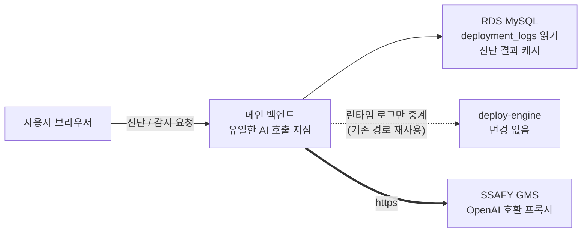
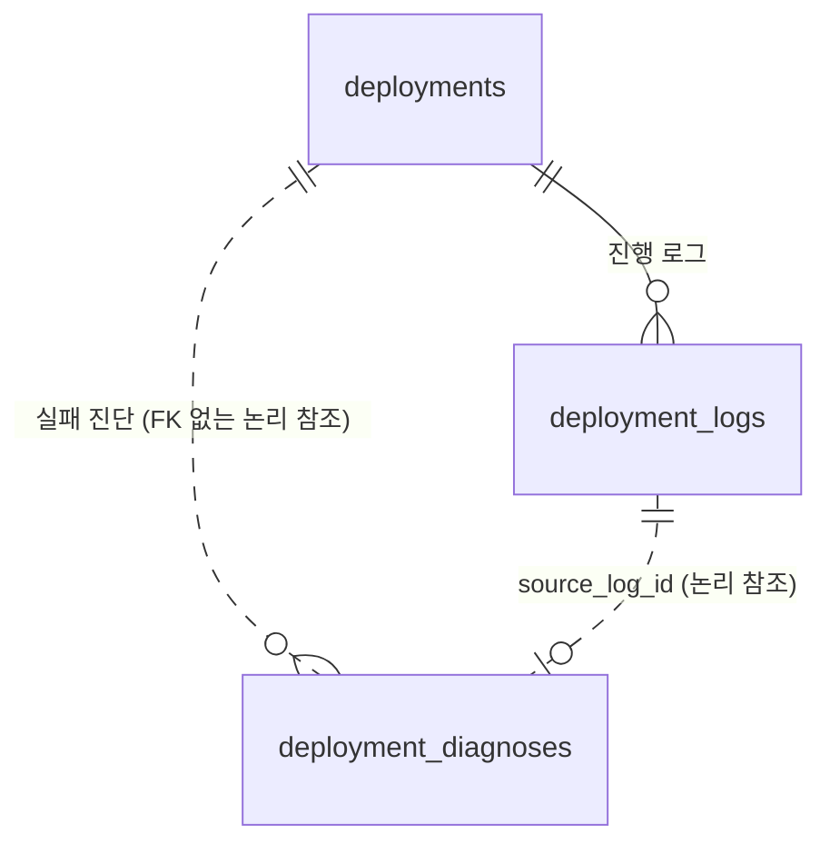

# AI 기능 요구사항 명세서

| | |
| --- | --- |
| **프로젝트명** | SSAFY Hub |
| **팀** | E206 (좋은게 좋은거지) |
| **문서 종류** | 요구사항 명세서 (What / How much) |
| **대상 범위** | AI 기반 **배포 실패 진단** · **런타임 로그 이상 감지** (2건) |
| **상위 문서** | [기획안](./기획안.md), [아키텍처](./architecture.md), [API 명세서](./API명세서.md), [ERD](./erd.md) |
| **자매 문서** | [AI 기능 기능명세서](./AI기능-기능명세서.md) — 동작 상세 |

---

## 목차

1. [문서 개요](#1-문서-개요)
2. [배경 — 왜 이 기능인가](#2-배경--왜-이-기능인가)
3. [시스템 배치 결정](#3-시스템-배치-결정)
4. [기능 요구사항](#4-기능-요구사항)
5. [비기능 요구사항](#5-비기능-요구사항)
6. [데이터 요구사항](#6-데이터-요구사항)
7. [API 요구사항](#7-api-요구사항)
8. [설정 및 환경변수](#8-설정-및-환경변수)
9. [화면 요구사항](#9-화면-요구사항)
10. [제약 및 가정](#10-제약-및-가정)
11. [수용 기준](#11-수용-기준)
12. [범위 밖](#12-범위-밖)
13. [리스크](#13-리스크)
14. [구현 순서](#14-구현-순서)
15. [추적성](#15-추적성)

---

## 1. 문서 개요

### 1.1 목적

SSAFY Hub에 추가할 AI 기능 2건의 요구사항을 확정한다. 이 문서는 **무엇을 만들 것인가**와
**어디까지가 완성인가**를 정의하며, 동작 상세는 [기능명세서](./AI기능-기능명세서.md)에 위임한다.

### 1.2 기능 목록

| ID | 기능 | 한 줄 정의 | 우선순위 |
| --- | --- | --- | :---: |
| **F1** | 배포 실패 AI 진단 | 실패한 배포의 로그를 읽어 원인·이유·해결 절차를 비전공자 언어로 설명한다 | Must |
| **F2** | 런타임 로그 이상 감지 | 실행 중인 앱의 로그에서 이상 징후를 찾아 지적하고 상태를 요약한다 | Should |

두 기능은 **같은 축**에 있다. F1은 **뜨지 못한 앱**의 실패 원인을, F2는 **떠 있지만
이상한 앱**의 문제 징후를 다룬다. 둘 다 "로그는 보이는데 읽을 수 없다"는 같은 문제를
같은 방식(로그 → 사람이 읽을 수 있는 설명)으로 해결한다.

### 1.3 용어

| 용어 | 정의 |
| --- | --- |
| **진단(Diagnosis)** | F1의 산출물. 실패 1건에 대해 생성되는 구조화된 원인 분석 결과 |
| **감지(Detection)** | F2의 산출물. 런타임 로그 스냅샷 1건에 대한 상태 판정과 이상 징후 목록 |
| **마스킹(Redaction)** | LLM에 텍스트를 보내기 전 비밀값을 치환하는 것 |
| **진단 캐시 키** | 해당 배포의 최신 `FAILED` 상태 `deployment_logs.id` |
| **실패 사이클** | 가장 최근 `RUNNING`/`FAILED` 로그 이후부터 현재 `FAILED`까지의 로그 구간 |

---

## 2. 배경 — 왜 이 기능인가

### 2.1 해결하려는 문제

기획안의 핵심 페르소나 정의는 다음과 같다.

> **어려워서 막힌 게 아니라 자기가 막힌 지점을 설명할 단어가 없어서** 검색도 질문도 못 한다.
> — [기획안 §4.2 김서비](./기획안.md)

현재 플랫폼은 `As-is → To-be` 표에서 **"실패 시 대응: 검색 → 추측 → 재시도" → "단계별 로그 확인"**
까지를 달성했다. 그러나 실제로 사용자에게 보이는 실패 로그는 다음 형태다.

```
배포 실패: [IllegalStateException] Pod team-a3f/20250 CrashLoopBackOff
제한시간 내에 Ready 상태가 되지 않음 - 실패한 컨테이너의 최근 로그:
  Caused by: com.mysql.cj.jdbc.exceptions.CommunicationsException: Communications link failure
```

**"단계별 로그 확인"은 로그를 읽을 수 있는 사람에게만 유효한 해결책이다.** 김서비는 이 로그를
봐도 여전히 검색할 단어가 없다. 남은 간극이 정확히 이 지점이고, F1이 그것을 메운다.

F2는 같은 문제의 다른 국면이다. 앱이 `RUNNING`으로 떠 있어도 로그에 오류가 반복되고 있으면
서비스는 사실상 동작하지 않는다. 현재 화면은 그 로그를 **그대로** 보여주는 데서 멈춘다.

### 2.2 기능별 문제 매핑

| 기능 | 대응하는 기획안 문제 | 목표 상태 |
| --- | --- | --- |
| F1 | §2.1 "원인 파악이 어려운 오류를 만나 중단한다" | 실패 화면에서 원인과 다음 행동을 안다 |
| F2 | §5.2 관찰 유저스토리 "리소스 문제를 인지하기 위해서다" | 떠 있지만 이상한 상태를 인지한다 |

### 2.3 이번 범위의 성격

이번 범위는 **실패 복구**에 집중한다. 실패를 사전에 막는 축(산출물 사전 점검)은
[§12 범위 밖](#12-범위-밖)으로 제외했다. 따라서 기획안 지표 중 **TTFD 단축에는 직접
기여하지 않으며**, `배포 성공률`에는 "실패한 사용자가 원인을 알고 재시도한다"는 경로로만
기여한다([§15.2](#152-성공-지표-기여) 참조).

---

## 3. 시스템 배치 결정

### 3.1 AI 호출은 메인 백엔드에서만 한다



**결정 근거**

| 근거 | 내용 |
| --- | --- |
| **입력 데이터가 이미 메인 백엔드 쪽에 있다** | deploy-engine이 파드 실패 로그까지 RDS `deployment_logs`에 기록하고(`DeploymentProcessor.java:283-287`), 메인 백엔드가 같은 RDS를 읽는다(`DeploymentLogRepository`) |
| **deploy-engine은 외부 egress를 전제할 수 없다** | `8081` 접근이 보안그룹 참조 전용이며, 설계상 공인망에 노출되지 않는다([아키텍처 §네트워크와 보안](./architecture.md)) |
| **메인 EC2는 외부 통신이 확인된 호스트다** | 같은 인스턴스의 Jenkins가 `npm ci` / `gradle build`를 수행한다 → 아웃바운드 인터넷 경로 존재 (단, [§10.1 A1](#101-검증이-필요한-가정)으로 실측 확인 필요) |

### 3.2 결론: deploy-engine 변경 없음

**두 기능 모두 `deploy-engine/` 디렉터리를 수정하지 않는다.** F2의 런타임 로그도 기존
`DevOpsDeploymentClient.getRuntimeLogs()` 중계 경로를 그대로 재사용한다.

### 3.3 F1 호출 방식: 지연 생성 (Lazy)

배포가 `FAILED`로 확정되는 시점은 deploy-engine이 알고 메인 백엔드는 모른다. 메인 백엔드가
이를 감지하려면 별도 폴링이 필요하다. 반면 **프론트엔드는 이미 `/logs`를 3초 간격으로 폴링하고
있다**(`useDeploymentLogs.js`).

따라서 **프론트가 `FAILED`를 관측한 시점에 진단 API를 1회 호출**하고, 백엔드는 캐시가 없을 때만
LLM을 호출한다. 새 폴링 루프를 추가하지 않는다.

### 3.4 F2 호출 방식: 명시적 트리거

F2는 **사용자 버튼 클릭으로만** 실행한다. 근거는 [FR-2.2](#fr-22-폴링에-연결하지-않는다-필수)에 있다.

---

## 4. 기능 요구사항

### 4.1 F1 — 배포 실패 AI 진단

#### FR-1.1 진단 생성

| | |
| --- | --- |
| **요구사항** | 배포가 실패한 경우, 해당 실패의 원인 진단을 생성해 반환한다 |
| **트리거** | 프론트엔드가 최신 배포 상태를 `FAILED`로 관측한 시점 (사용자 조작 불필요) |
| **엔드포인트** | `POST /api/v1/deployments/{deploymentId}/diagnosis` |
| **권한** | 본인 배포만. 타인 배포 요청은 `DEPLOYMENT_004` |

#### FR-1.2 진단 입력 데이터

LLM에 전달하는 입력은 아래로 **한정**한다.

| 입력 | 출처 | 비고 |
| --- | --- | --- |
| 배포 진행 로그 | `deployment_logs` | **실패 사이클 구간만.** 재배포 이력이 섞이면 진단이 오염된다 |
| 배포 설정 | `deployments` | `techStack`, `runtimeVersion`, `internalPort`, DB 사용 여부, DB 엔진 |
| 환경변수 **키 이름만** | `deployment_envs` | **값은 절대 전송하지 않는다** ([FR-1.6](#fr-16-비밀값-마스킹-필수)) |

`deployment_logs`에는 이미 파드 실패 로그와 스택트레이스가 포함되어 있으므로
(`DeploymentProcessor.java:283-287`) 추가 수집 경로가 필요 없다.

#### FR-1.3 진단 출력 형식

구조화된 형식으로 고정한다. 자유 서술 텍스트는 허용하지 않는다.

| 필드 | 타입 | 설명 |
| --- | --- | --- |
| `summary` | string | 원인 한 줄. 전문용어 없이 |
| `detail` | string | 왜 그렇게 되었는지. 비전공 교육생 기준 설명 |
| `actions[]` | array | 해결 절차. `{ title, description }` |
| `logLineNumbers[]` | int[] | 근거가 된 로그 줄 번호 (전송 시 부여한 1-based 번호) |
| `confidence` | enum | `HIGH` / `MEDIUM` / `LOW` |

**`logLineNumbers`는 필수다.** 근거 없는 진단은 사용자가 검증할 수 없고, 틀렸을 때 더 큰
혼란을 만든다.

#### FR-1.4 진단 결과 캐싱

| | |
| --- | --- |
| **캐시 키** | `(deployment_id, source_log_id)` — `source_log_id`는 최신 `FAILED` 로그의 id |
| **동작** | 같은 키의 진단이 있으면 LLM을 호출하지 않고 저장된 결과를 반환한다 |
| **결과** | **실패 1건당 LLM 호출 1회**로 상한이 고정된다 |
| **재배포 시** | 새 `FAILED` 로그 → 새 `source_log_id` → 새 진단 생성 (이전 진단은 이력으로 남는다) |

#### FR-1.5 조회 전용 엔드포인트

`GET /api/v1/deployments/{deploymentId}/diagnosis` 는 **저장된 진단만 반환하고 LLM을 호출하지
않는다.** 화면 재진입 시 비용이 발생하지 않게 하기 위한 분리다.

#### FR-1.6 비밀값 마스킹 (필수)

LLM 전송 전 아래를 치환한다. 이 요구사항은 협상 불가다.

| 대상 | 처리 |
| --- | --- |
| `deployment_envs.encrypted_value` | **복호화하지 않는다.** 키 이름만 전송 |
| `deployments.encrypted_database_password` | 전송하지 않는다 |
| 로그 본문 내 비밀 패턴 | `password=`, `token=`, `secret=`, `Authorization:`, JDBC URL의 자격증명 구간, AWS 키 형식 문자열, JWT, PEM 블록을 `***`로 치환 |

#### FR-1.7 실패 이외 상태

배포가 `FAILED`가 아니면 진단을 생성하지 않고 `AI_004`(진단 대상 아님)를 반환한다.

---

### 4.2 F2 — 런타임 로그 이상 감지

#### FR-2.1 감지 실행

| | |
| --- | --- |
| **요구사항** | 실행 중인 앱의 최근 로그 스냅샷에서 이상 징후를 찾아 상태와 함께 제시한다 |
| **트리거** | **사용자의 명시적 버튼 클릭만** |
| **엔드포인트** | `POST /api/v1/deployments/{deploymentId}/runtime-logs/detection` |
| **전제** | 최신 상태가 `RUNNING`일 때만 가능 |

#### FR-2.2 폴링에 연결하지 않는다 (필수)

`useRuntimeLogs.js`는 5초 간격 폴링이다. **감지를 이 폴링에 연결하면 사용자 1명이 화면을
열어둔 것만으로 시간당 720회 LLM 호출이 발생한다.** 감지는 폴링과 완전히 분리된
버튼 트리거로만 동작해야 한다.

#### FR-2.3 쿨다운

배포당 최소 호출 간격 **30초**. 이내 재요청은 `AI_003`(요청이 너무 잦음)을 반환하고
LLM을 호출하지 않는다.

#### FR-2.4 감지 출력 형식

| 필드 | 타입 | 설명 |
| --- | --- | --- |
| `health` | enum | `HEALTHY` / `WARNING` / `ERROR` / `UNKNOWN` |
| `summary` | string | 지금 앱이 어떤 상태인지 한두 문장 |
| `findings[]` | array | 이상 징후. `{ severity, title, detail, suggestion }` |
| `nextSteps[]` | string[] | 권장 조치 |

**`health`가 1차 산출물이다.** 사용자가 알고 싶은 것은 "지금 괜찮은가"이고, `findings`는
그 판정의 근거다.

#### FR-2.5 정상일 때 정상이라고 말한다

문제가 없으면 `health: HEALTHY`, `findings: []`를 반환해야 한다.
**없는 문제를 만들어내서는 안 된다.** 프레임워크가 기동 중 출력하는 일반적인 경고나
`INFO` 로그를 이상 징후로 보고하지 않는다.

#### FR-2.6 입력 마스킹

[FR-1.6](#fr-16-비밀값-마스킹-필수)과 동일한 마스킹을 적용한다. 런타임 로그는 앱이 직접
출력하는 텍스트라, 사용자 코드가 비밀값을 로그로 찍었을 가능성이 오히려 더 높다.

#### FR-2.7 결과는 저장하지 않는다

런타임 로그는 계속 변하므로 캐싱이 무의미하다. 감지 결과는 DB에 저장하지 않고
응답으로만 반환한다. (F1과의 설계 차이)

#### FR-2.8 분석할 로그가 없을 때

로그가 비어 있거나 deploy-engine이 조회 실패 문구를 반환한 경우, **LLM을 호출하지 않고**
`health: UNKNOWN`으로 응답한다. 오류로 처리하지 않는다.

---

### 4.3 공통 요구사항

#### FR-C.1 기능 토글

| | |
| --- | --- |
| **설정** | `ai.enabled` (기본 `false`) |
| **자동 비활성** | API 키가 주입되지 않으면 `ai.enabled` 값과 무관하게 모델 호출이 비활성 |
| **비활성 시 동작** | AI 기능이 애플리케이션에 흔적을 남기지 않는다. **그 외 모든 기존 기능은 영향받지 않는다** |

이 요구사항의 목적은 **키를 넣지 않은 상태로 배포해도 현재 프로덕션 동작이 그대로여야 한다**는
것이다.

비활성 시 응답은 두 갈래다.

| 상황 | 응답 |
| --- | --- |
| `ai.enabled=false` | AI 기능 빈이 등록되지 않아 해당 경로가 존재하지 않는다 → **404** |
| `ai.enabled=true` + API 키 미주입 | 경로는 있으나 모델 호출이 불가 → **`AI_001`** |

`GET /api/v1/ai/availability`는 **토글과 무관하게 항상 응답한다.** 프론트엔드는 이 값으로
AI UI 렌더링 여부를 판단하므로(UI-8), 위 404를 실제로 만나지 않는다.

#### FR-C.2 AI 실패가 기존 기능을 깨지 않는다

| 상황 | 동작 |
| --- | --- |
| GMS 타임아웃 / 4xx / 5xx | `AI_002`(일시적 실패). 화면은 로그·리소스 등 기존 정보를 계속 표시 |
| 응답이 스키마와 불일치 | `AI_002`. 부분 파싱 결과를 억지로 보여주지 않는다 |
| 안전 정책상 응답 거부 | `AI_002`. `stop_reason` 확인 후 처리 |

기존 화면 요소(`LogViewer`, `ResourceDashboard`)는 AI 실패와 무관하게 동작해야 한다.

#### FR-C.3 출력 언어와 어조

| 항목 | 요구사항 |
| --- | --- |
| 언어 | 한국어 |
| 대상 독자 | **비전공 1학기 수료 교육생** (기획안 페르소나 김서비) |
| 금지 | 근거 없는 단정, 사용자가 확인할 수 없는 추측을 사실처럼 서술 |
| 요구 | 모르면 확신도를 낮게 표시. 로그 줄 번호로 근거 제시 |

#### FR-C.4 실행 가능한 조치만 제안한다

이 플랫폼 사용자는 SSH 접속, `kubectl` 실행, Dockerfile 수정, nginx 설정 변경을
**할 수 없다.** 제안하는 조치는 사용자가 화면에서 실제로 수행할 수 있는 것으로 한정한다 —
환경변수 수정, 산출물 재업로드, 포트·DB 설정 변경, 재배포, 배포 삭제 후 재생성.

> 이 요구사항이 없으면 일반적인 배포 오류 해결책(대부분 서버 접속을 전제한다)을 제안해
> 사용자를 다시 막히게 만든다. 기획안이 없애려던 좌절을 AI가 재생산하는 셈이다.

---

## 5. 비기능 요구사항

### 5.1 비용

| ID | 요구사항 | 통제 수단 |
| --- | --- | --- |
| NFR-1.1 | F1은 배포 실패 1건당 LLM 호출 1회를 초과하지 않는다 | `(deployment_id, source_log_id)` 캐시 |
| NFR-1.2 | F2는 배포당 30초 1회를 초과하지 않는다 | 쿨다운 + 버튼 전용 트리거 |
| NFR-1.3 | 전송 입력 크기 상한을 둔다 | F1 로그 구간 400줄, F2 로그 tail 300줄 |
| NFR-1.4 | 사용량을 사후에 확인할 수 있다 | 호출별 입력·출력 토큰 수와 모델명을 애플리케이션 로그에 남긴다 |

#### 예상 호출량 (베타 테스트 기준)

| 시나리오 | F1 | F2 |
| --- | --- | --- |
| 사용자 30명 × 평균 배포 시도 3회 × 실패율 30% | 약 27회 | – |
| 사용자 30명 × 자발적 분석 2회 | – | 약 60회 |

`ai.enabled=false`로 배포하면 0회다.

### 5.2 성능

| ID | 요구사항 |
| --- | --- |
| NFR-2.1 | AI 호출 타임아웃은 60초. 초과 시 `AI_002` |
| NFR-2.2 | AI 호출은 기존 API 응답 경로를 블로킹하지 않는다 (별도 엔드포인트로 분리) |
| NFR-2.3 | F1 진단 캐시 조회는 단일 인덱스 조회로 처리한다 |

### 5.3 보안

| ID | 요구사항 |
| --- | --- |
| NFR-3.1 | 환경변수 값, DB 비밀번호를 LLM에 전송하지 않는다 ([FR-1.6](#fr-16-비밀값-마스킹-필수)) |
| NFR-3.2 | 로그 본문의 비밀 패턴을 마스킹한 뒤 전송한다 |
| NFR-3.3 | API 키는 소스·설정 파일에 하드코딩하지 않고 주입받는다 |
| NFR-3.4 | 모든 AI 엔드포인트는 인증 필수, 본인 리소스만 접근 가능 |
| NFR-3.5 | 상태 변경 메서드(`POST`)이므로 기존 CSRF 정책을 그대로 적용한다 |
| NFR-3.6 | AI 응답은 화면에 **텍스트로만** 렌더링한다. HTML/마크다운을 실행 가능한 형태로 삽입하지 않는다 |
| NFR-3.7 | 로그 본문은 신뢰할 수 없는 입력으로 취급한다. 로그에 포함된 지시문 형태의 텍스트를 따르지 않는다 |

> NFR-3.6·3.7은 **사용자 코드가 출력한 로그가 LLM을 거쳐 화면에 도달하는 경로**가
> 새로 생기기 때문에 필요하다. 두 기능 모두 이 경로를 만든다.

### 5.4 가용성

| ID | 요구사항 |
| --- | --- |
| NFR-4.1 | AI 기능 장애가 배포·조회·삭제 등 기존 기능에 영향을 주지 않는다 |
| NFR-4.2 | API 키 없이도 애플리케이션이 정상 기동한다 |
| NFR-4.3 | AI 기능은 설정만으로 즉시 끌 수 있다 |

### 5.5 관측성

| ID | 요구사항 |
| --- | --- |
| NFR-5.1 | AI 호출마다 대상 리소스 id, 모델명, 토큰 사용량, 소요 시간, 성공 여부를 로그로 남긴다 |
| NFR-5.2 | 마스킹 후 전송한 텍스트 원문은 로그에 남기지 않는다 |

---

## 6. 데이터 요구사항

### 6.1 신규 테이블 — `deployment_diagnoses`

F1의 진단 결과를 저장한다. 스키마는 엔티티에서 `JPA_DDL_AUTO=update`로 생성된다
([ERD 문서 원칙](./erd.md)과 동일).

| 컬럼 | 타입 | 제약 | 설명 |
| --- | --- | --- | --- |
| `id` | bigint | PK, auto | |
| `deployment_id` | bigint | NOT NULL, **FK 없음** | [§6.3](#63-fk를-두지-않는-이유) 참조 |
| `source_log_id` | bigint | NOT NULL | 진단 대상이 된 `deployment_logs.id` (캐시 키) |
| `payload_json` | TEXT | NOT NULL | [FR-1.3](#fr-13-진단-출력-형식) 구조를 직렬화한 JSON |
| `model` | varchar(60) | | 사용한 모델 식별자 |
| `input_tokens` | int | | 사용량 추적용 |
| `output_tokens` | int | | 사용량 추적용 |
| `created_at` | datetime | NOT NULL | |

**제약**

- `UNIQUE (deployment_id, source_log_id)` — 같은 실패에 대한 중복 진단 방지
- `INDEX (deployment_id, id DESC)` — 최신 진단 조회

`payload_json`을 개별 컬럼으로 쪼개지 않는 이유: 출력 구조가 아직 변할 여지가 있고,
조건 검색 대상이 아니라 항상 통째로 읽히는 데이터이기 때문이다.

### 6.2 관계도 (변경분)



### 6.3 FK를 두지 않는 이유

`deployment_id`에 FK를 걸면 배포 삭제 시 이 테이블을 먼저 비워야 하고, 그러려면
`DeploymentService.deleteDeployment()`를 수정해야 한다. **그 경로는 이미 팀 검증이 끝난
삭제 로직이므로, 부가 기능 때문에 손대지 않는다**([C6](#102-기술-제약)).

같은 이유로 FK를 두지 않은 `deployment_outbox`와 동일한 방식이다.

| 항목 | 처리 |
| --- | --- |
| 배포 삭제 시 | 진단 행이 남는다. 삭제는 절대 실패하지 않는다 |
| 고아 행 정리 | 전용 스케줄러가 하루 1회 `deployment_id`가 존재하지 않는 행을 삭제한다 |
| 정리 실패 시 | 로그만 남기고 다음 주기에 재시도한다. 애플리케이션에 영향 없음 |

`source_log_id`도 FK를 걸지 않는다. 논리 참조로만 쓰인다.

### 6.4 F2의 데이터 요구사항

**없다.** 감지 결과를 저장하지 않는다([FR-2.7](#fr-27-결과는-저장하지-않는다)).
쿨다운 상태는 인메모리로 관리한다.

### 6.5 기존 테이블 변경

**없다.** 기존 테이블과 응답 DTO를 모두 그대로 둔다.

당초 `deployment_logs` 응답에 `id`를 노출해 프론트가 캐시 키를 판별하게 하려 했으나,
**진단 응답이 분석에 사용한 로그 발췌를 직접 담는 방식으로 대체했다.** 프론트는 `/logs`
API에도 `LogViewer` 컴포넌트에도 의존하지 않으며, 비용 상한은 서버 측 캐시가 그대로 보장한다
([§7.3](#73-기존-api-변경) 참조).

---

## 7. API 요구사항

### 7.1 엔드포인트 목록

| # | Method | Path | 기능 | 인증 | CSRF | LLM 호출 |
| --- | --- | --- | --- | :---: | :---: | :---: |
| 1 | `POST` | `/api/v1/deployments/{id}/diagnosis` | F1 진단 생성 (캐시 우선) | O | O | 조건부 |
| 2 | `GET` | `/api/v1/deployments/{id}/diagnosis` | F1 저장된 진단 조회 | O | – | **없음** |
| 3 | `POST` | `/api/v1/deployments/{id}/runtime-logs/detection` | F2 이상 감지 | O | O | 조건부 |
| 4 | `GET` | `/api/v1/ai/availability` | AI 활성 여부 + 클라이언트 설정값 | O | – | **없음** |

4번 응답은 `{ enabled, runtimeLogCooldownSeconds }`다. 쿨다운 간격을 함께 내려주는 이유는
기존 예외 핸들러가 에러 응답에 데이터를 담지 않아 `AI_003`에 남은 초를 실을 수 없기 때문이다
(제약 C6 — 공통 예외 핸들러를 수정하지 않는다). 프론트엔드는 이 값으로 자체 카운트다운한다.

응답은 기존 공통 포맷(`ApiResponse<T>`)을 따른다. 구현 완료 후 상세 스펙은
[API 명세서](./API명세서.md)에 편입한다.

### 7.2 신규 에러 코드

| 코드 | HTTP | 메시지 | 발생 조건 |
| --- | :---: | --- | --- |
| `AI_001` | 503 | AI 기능이 현재 비활성 상태입니다. | 기능 토글 off 또는 키 미주입 |
| `AI_002` | 502 | AI 분석에 일시적으로 실패했습니다. 잠시 후 다시 시도해 주세요. | 타임아웃 / 5xx / 스키마 불일치 / 응답 거부 |
| `AI_003` | 429 | 요청이 너무 잦습니다. 잠시 후 다시 시도해 주세요. | F2 쿨다운 위반 |
| `AI_004` | 400 | 분석할 수 있는 상태가 아닙니다. | F1을 `FAILED` 아닌 배포에, F2를 `RUNNING` 아닌 배포에 요청 |

기존 코드는 그대로 재사용한다 — `DEPLOYMENT_004`(배포 없음/타인 배포).

### 7.3 기존 API 변경

**없다.**

진단 응답이 `analyzedLog`(마스킹된 로그 발췌 + 줄 번호)와 `sourceLogId`를 함께 담으므로,
프론트엔드는 기존 `/logs` 응답에서 로그 id를 얻을 필요가 없다.

| 당초 설계 | 대체 방식 |
| --- | --- |
| 프론트가 `/logs`의 `id`로 `sourceLogId`를 판별해 쿼리 키에 넣는다 | 프론트는 상태가 `FAILED`일 때 진단을 1회 요청한다. **서버가 `sourceLogId`로 캐시**하므로 여러 번 호출해도 LLM 호출은 늘지 않는다 |
| 근거 줄 클릭 시 `LogViewer`의 해당 줄로 이동 | 진단 카드가 `analyzedLog` 발췌를 자체 렌더링한다. `LogViewer`를 수정하지 않는다 |

비용 요구사항(NFR-1.1)은 서버 캐시가 전적으로 보장한다. 프론트 쿼리 키는 애초에
HTTP 왕복을 줄이는 최적화였을 뿐이다.

---

## 8. 설정 및 환경변수

### 8.1 애플리케이션 설정

```yaml
ai:
  enabled: ${AI_ENABLED:false}
  api-key: ${OPENAI_API_KEY:}
  base-url: ${OPENAI_BASE_URL:https://gms.ssafy.io/gmsapi/api.openai.com/v1}
  model: ${AI_MODEL:gpt-4.1}
  max-tokens: ${AI_MAX_TOKENS:4000}
  connect-timeout-ms: ${AI_CONNECT_TIMEOUT_MS:5000}
  read-timeout-ms: ${AI_READ_TIMEOUT_MS:60000}
  failure-diagnosis:
    max-log-lines: ${AI_DIAGNOSIS_MAX_LOG_LINES:400}
  runtime-log-detection:
    cooldown-seconds: ${AI_RUNTIME_LOG_COOLDOWN_SECONDS:30}
    tail: ${AI_RUNTIME_LOG_TAIL:300}
```

### 8.2 주입 필요 항목

| 환경변수 | 필수 | 설명 |
| --- | :---: | --- |
| `OPENAI_API_KEY` | AI 기능 사용 시 | SSAFY GMS 발급 키. 미설정이면 AI 기능만 비활성 ([FR-C.1](#fr-c1-기능-토글)) |
| `OPENAI_BASE_URL` | – | 기본 `https://gms.ssafy.io/gmsapi/api.openai.com/v1` |
| `AI_ENABLED` | – | 기본 `false`. 프로덕션 활성화 시 `true` |
| `AI_MODEL` | – | 기본 `gpt-4.1`. GMS에서 `gpt-4o`/`gpt-4.1-mini`/`gpt-4o-mini`도 사용 가능 확인 |

주입 방식은 기존 시크릿과 동일한 패턴(`JWT_SECRET`, `SECRET_ENCRYPTION_KEY`)을 따른다 —
Jenkins credential → 컨테이너 환경변수. 아키텍처 문서상 SSM Parameter Store도 존재하므로
운영 정책에 따라 대체 가능하다.

### 8.3 배포 영향

`docs/architecture.md` §CI/CD에 따라 `backend/**` 변경은 백엔드 잡을,
`frontend/**` 변경은 프론트엔드 잡을 트리거한다. 이 작업은 **두 잡 모두**를 트리거한다.
`docs/**`만 바뀌는 이 문서 자체는 배포를 유발하지 않는다.

---

## 9. 화면 요구사항

| ID | 화면 | 요구사항 |
| --- | --- | --- |
| UI-1 | `ManagePage` | 상태가 `FAILED`일 때 기존 로그 뷰어 **위**에 진단 카드를 표시한다. 원인 → 이유 → 해결 체크리스트 순 |
| UI-2 | `ManagePage` | 진단 생성 중 로딩 상태를 표시한다. 실패 시 카드만 숨기고 로그 뷰어는 정상 표시 |
| UI-3 | `ManagePage` | 근거 로그 줄 번호를 클릭하면 로그 뷰어의 해당 줄로 이동한다 |
| UI-4 | `RuntimeLogsPage` | "이상 징후 확인" 버튼을 제공한다. **자동 실행하지 않는다** ([FR-2.2](#fr-22-폴링에-연결하지-않는다-필수)) |
| UI-5 | `RuntimeLogsPage` | 쿨다운 중에는 버튼을 비활성화하고 남은 시간을 표시한다 |
| UI-6 | `RuntimeLogsPage` | `health` 값을 색상과 문구로 구분해 표시한다. `HEALTHY`면 "특별한 문제가 보이지 않습니다"를 명시적으로 보여준다 |
| UI-7 | 공통 | AI 결과에 "AI가 생성한 분석" 표시와 확신도를 함께 노출한다 |
| UI-8 | 공통 | `ai.enabled=false`면 AI 관련 UI 요소를 렌더링하지 않는다 |

UI-7은 사용자가 결과를 **검증 가능한 참고 자료**로 인식하게 하기 위한 요구사항이다.
AI 진단을 플랫폼의 확정 판단으로 보이게 만들면, 틀렸을 때 기획안이 해결하려던
"좌절" 문제를 오히려 키운다.

UI-6은 [FR-2.5](#fr-25-정상일-때-정상이라고-말한다)의 화면 대응이다. "문제 없음"을
빈 화면으로 표현하면 사용자는 기능이 동작하지 않았다고 오해한다.

---

## 10. 제약 및 가정

### 10.1 검증이 필요한 가정

| ID | 가정 | 검증 방법 | 틀렸을 경우 |
| --- | --- | --- | --- |
| **A1** | 메인 백엔드 EC2에 `gms.ssafy.io` 아웃바운드 경로가 있다 | 인스턴스에서 실측 | NAT/보안그룹 아웃바운드 규칙 추가 |
| **A2** | `deployment_logs`의 실패 로그에 원인 판단에 충분한 정보가 있다 | 실제 실패 사례 5건 이상으로 진단 품질 확인 | 로그 수집 범위 확대 (deploy-engine 변경 필요) |
| **A3** | 사내 규정상 사용자 배포 로그를 외부 AI API로 전송할 수 있다 | **사내 확인 필요** | 기능 전체 재검토 |

> **A3은 착수 전 확인이 필요한 항목이다.** 기획안 §10.2에 "소스 코드 외부 공개 금지"
> 리스크가 이미 기재되어 있다. 전송 대상은 소스 코드 본문이 아니라 배포 로그와 환경변수
> 키 이름 수준이지만, 판단은 사내 규정에 따른다.
>
> **A3이 불가로 판정되면 이번 범위의 두 기능 모두 성립하지 않는다.** 둘 다 로그 전송을
> 전제하기 때문이다.

### 10.2 기술 제약

| ID | 제약 |
| --- | --- |
| C1 | deploy-engine을 수정하지 않는다 ([§3.2](#32-결론-deploy-engine-변경-없음)) |
| C2 | 기존 API 응답 스키마를 변경하지 않는다 |
| C3 | 기존 폴링 주기(로그 3초, 런타임 로그 5초)를 변경하지 않는다 |
| C4 | 기존 배포 검증 로직을 AI 결과로 대체하지 않는다 |
| C5 | 백엔드는 Java 21 / Spring Boot 3.5.16 기준 |
| **C6** | **기존 파일을 수정하지 않는다.** 팀원이 기능 테스트를 완료한 코드이므로, AI 기능은 신규 파일로만 구성한다 |

#### C6의 적용 범위와 예외

C6은 **가장 강한 제약**이며 설계 선택을 지배한다. 다음 3건은 C6 때문에 당초 설계를 바꾼 것이다.

| 원래 필요했던 수정 | 우회 방법 |
| --- | --- |
| `DeploymentController`에 엔드포인트 추가 | 별도 컨트롤러로 분리. `/{id}/diagnosis` 경로는 기존에 없어 매핑 충돌이 없다 |
| `DeploymentService.deleteDeployment()`에 진단 정리 추가 | FK를 두지 않아 삭제가 실패할 수 없게 한다([§6.3](#63-fk를-두지-않는-이유)) |
| `DeploymentLogResponse`에 `id` 추가 | 진단 응답이 로그 발췌를 직접 담는다([§7.3](#73-기존-api-변경)) |

**예외 2건** — 공통 기반(S0) 단계에서 아래 파일에 **삭제·수정 없이 추가만** 했다.
설정 블록과 에러 코드는 추가 없이 도입할 방법이 없다.

| 파일 | 추가 | 성격 |
| --- | ---: | --- |
| `application.yml` | 19줄 | `ai:` 블록 (기존 키 미변경) |
| `global/error/ErrorCode.java` | 9줄 | enum 맨 뒤에 상수 4개 (기존 상수의 ordinal 불변) |

`build.gradle`은 **건드리지 않았다.** GMS가 OpenAI 호환 HTTP API라 이미 있는
Spring `RestClient`로 호출하면 되기 때문이다.

### 10.3 개발 환경 참고

로컬에 JDK가 PATH에 등록되어 있지 않다. IntelliJ 번들 JBR(Java 25)로 Gradle 9.3.0 빌드가
동작함을 확인했다.

**새 의존성을 추가하지 않는다.** GMS는 OpenAI 호환 HTTP API이므로 이미 프로젝트에 있는
Spring `RestClient`로 호출한다(deploy-engine 호출과 같은 방식). 그래서 `build.gradle`은
원본 그대로다.

---

## 11. 수용 기준

### 11.1 F1

- [ ] 배포 실패 시 진단 카드가 자동으로 표시된다 (별도 조작 없이)
- [ ] 진단에 원인·이유·해결 절차·근거 줄 번호가 모두 포함된다
- [ ] 같은 실패에 대해 화면을 10회 재진입해도 LLM 호출은 1회다
- [ ] 재배포 후 다시 실패하면 새 진단이 생성된다
- [ ] `RUNNING` 상태 배포에 진단을 요청하면 `AI_004`가 반환된다
- [ ] 타인 배포 id로 요청하면 `DEPLOYMENT_004`가 반환된다
- [ ] LLM에 전송된 페이로드에 환경변수 값과 DB 비밀번호가 없다
- [ ] 제안된 조치에 SSH·kubectl·Dockerfile 수정이 포함되지 않는다
- [ ] AI 호출이 실패해도 로그 뷰어는 정상 동작한다
- [ ] 배포 삭제 시 진단 행이 함께 삭제된다

### 11.2 F2

- [ ] "이상 징후 확인" 버튼 클릭 시에만 호출된다
- [ ] 화면을 5분간 열어두어도 자동 호출이 0회다
- [ ] 30초 내 재요청 시 `AI_003`이 반환되고 LLM을 호출하지 않는다
- [ ] `RUNNING`이 아닌 배포에서는 버튼이 비활성이다
- [ ] 로그가 비어 있으면 `health=UNKNOWN`이 반환되고 LLM을 호출하지 않는다
- [ ] 정상 기동 로그만 있는 배포에서 `health=HEALTHY`, `findings`가 빈 배열로 반환된다
- [ ] LLM 호출이 실패하면 쿨다운이 갱신되지 않아 즉시 재시도할 수 있다

### 11.3 공통

- [ ] `OPENAI_API_KEY` 없이 애플리케이션이 정상 기동한다
- [ ] `ai.enabled=false`에서 기존 기능 전체가 회귀 없이 동작한다
- [ ] AI 결과에 "AI 생성" 표시와 확신도가 노출된다
- [ ] AI 응답이 HTML로 실행되지 않는다 (텍스트 렌더링)
- [ ] 로그에 포함된 지시문 형태 텍스트가 지시로 처리되지 않는다
- [ ] 호출별 토큰 사용량이 애플리케이션 로그로 확인된다
- [ ] 프롬프트 본문이 애플리케이션 로그에 남지 않는다

---

## 12. 범위 밖

| 항목 | 이유 |
| --- | --- |
| **산출물 사전 점검** (업로드한 JAR/ZIP 설정을 읽어 배포 폼 자동 채우기) | **팀 결정으로 이번 범위에서 제외.** 사용자 가치는 크지만(TTFD 단축) 실제로 필요한 작업의 대부분이 정적 파싱이라 AI 기능으로서의 비중이 작고, 스택별 파싱 규칙 구현량이 두 기능 합보다 크다. 별도 과제로 분리 |
| 자동 수정 / 자동 재배포 | 사용자가 원인을 이해하는 것이 목표다. 자동 수정은 학습 기회를 없애고 실패 시 책임 소재가 불분명해진다 |
| 대화형 챗봇 | 기획안의 문제 정의(배포 인프라 접근성)와 거리가 멀다 |
| 쇼케이스 설명 자동 생성 / 시맨틱 검색 | 핵심 문제와 무관하며, 후자는 임베딩 인프라가 추가로 필요하다 |
| 코드 본문 리뷰 | 산출물은 빌드 결과물이며, 소스 리뷰는 CI의 n8n이 이미 담당한다 |
| F2 결과 이력 저장·추이 분석 | 스냅샷 기반이라 시계열 의미가 약하다. 리소스 모니터링이 이미 시계열을 담당한다 |
| 진단 결과 스트리밍 | 1회성 짧은 응답이라 스트리밍 이득이 없다 |
| 다국어 출력 | 사용자가 전원 국내 교육생이다 |

---

## 13. 리스크

| 리스크 | 영향 | 대응 |
| --- | :---: | --- |
| **AI가 틀린 원인을 자신 있게 제시** | 높음 | 근거 줄 번호 필수([FR-1.3](#fr-13-진단-출력-형식)), 확신도 노출(UI-7), "AI 생성" 표시 |
| **사내 규정상 외부 AI 전송 불가** (A3) | 높음 | 착수 전 확인. 불가 시 두 기능 모두 중단 |
| **실행 불가능한 조치 제안** | 중간 | [FR-C.4](#fr-c4-실행-가능한-조치만-제안한다), 수용 기준으로 검증 |
| **F2가 없는 문제를 만들어냄** | 중간 | [FR-2.5](#fr-25-정상일-때-정상이라고-말한다), 정상 로그로 `HEALTHY` 검증 |
| **비용 폭증** | 중간 | 캐싱(NFR-1.1), 쿨다운(NFR-1.2), 폴링 분리([FR-2.2](#fr-22-폴링에-연결하지-않는다-필수)), 사용량 로깅(NFR-1.4) |
| **비밀값 유출** | 높음 | 값 미복호화 원칙([FR-1.6](#fr-16-비밀값-마스킹-필수)), 패턴 마스킹, 수용 기준으로 검증 |
| **아웃바운드 경로 부재** (A1) | 중간 | 실측 후 보안그룹/NAT 조정 |
| **로그 프롬프트 인젝션** | 낮음 | NFR-3.7, 텍스트 렌더링(NFR-3.6), 구조화 출력으로 형식 고정 |
| **일정 압박** | 낮음 | F1만으로도 독립적으로 가치가 성립한다. F2는 순차 반영 |

---

## 14. 구현 순서

각 단계는 **독립적으로 배포 가능**해야 한다.

| 단계 | 내용 | 완료 판정 |
| --- | --- | --- |
| **S0** | 공통 AI 기반 — 클라이언트, 설정, 기능 토글, 마스킹 유틸, 에러 코드, `availability` 엔드포인트 | 키 없이 기동 성공, 기존 기능 회귀 없음 |
| **S1** | **F1 백엔드** — 진단 엔티티/캐시/서비스/엔드포인트, 로그 구간 추출, 삭제 정합성, `DeploymentLogResponse.id` 추가 | [§11.1](#111-f1) 중 백엔드 항목 통과 |
| **S2** | **F1 프론트** — 진단 카드, `ManagePage` 연결, 근거 줄 이동 | [§11.1](#111-f1) 전체 통과 → **최소 출하 단위** |
| **S3** | **F2 백엔드** — 감지 서비스, 쿨다운, 엔드포인트 | [§11.2](#112-f2) 중 백엔드 항목 통과 |
| **S4** | **F2 프론트** — 감지 패널, `RuntimeLogsPage` 연결 | [§11.2](#112-f2) 전체 통과 |
| **S5** | 문서 반영 — API 명세서, ERD, 런북에 편입 | 문서 갱신 완료 |

S2까지 완료하면 기획안의 핵심 문제([§2.1](#21-해결하려는-문제))가 해소된다.
S3·S4는 그 위의 개선이다.

---

## 15. 추적성

### 15.1 기획안 ↔ 요구사항

| 기획안 항목 | 대응 요구사항 |
| --- | --- |
| §2.1 원인 파악이 어려운 오류로 중단 | F1 전체 |
| §4.2 "막힌 지점을 설명할 단어가 없다" | FR-1.3, FR-C.3 |
| §4.2 "터미널을 열지 않고" | FR-C.4 |
| §5.2 관찰 — "실패했을 때 원인을 파악하고" | FR-1.1, FR-1.3 |
| §5.2 관찰 — "리소스 문제를 인지하기 위해서다" | F2 전체 |
| §6.1 As-is→To-be "실패 시 대응: 단계별 로그 확인" | F1 (로그 → 설명으로 한 단계 전진) |
| §6.3 감정 곡선 — "첫 오류: 로그로 원인 확인" | FR-1.3 |
| §8.1 Could have "애플리케이션 런타임 로그" | F2 (이미 구현된 런타임 로그 위에 얹는다) |
| §10.2 리스크 "소스 코드 외부 공개 금지" | A3, NFR-3.1, NFR-3.2 |

### 15.2 성공 지표 기여

| 기획안 지표 | 목표 | 기여 | 기여 방식 |
| --- | --- | :---: | --- |
| 재배포율 | 50% | **직접** | 원인을 알면 재시도한다. 모르면 이탈한다 (F1) |
| 배포 성공률 | 90% 이상 | **간접** | 실패를 예방하지는 않고, 실패를 복구 가능하게 만든다 (F1) |
| 문의·오류 리포트 | 배포 10건당 1건 이하 | **직접** | 자가 해결 비율 상승 (F1, F2) |
| 만족도 | 4.0 이상 | **간접** | 좌절 지점 완화 |
| TTFD | 15분 이내 | **없음** | 실패 예방 축(산출물 사전 점검)을 범위에서 제외했다 |

> `TTFD`에 기여하는 기능이 이번 범위에 없다는 점을 명시한다. 지표 개선을 목표로
> 한다면 [§12](#12-범위-밖)의 산출물 사전 점검을 별도 과제로 다시 검토해야 한다.

### 15.3 코드 참조

이 문서가 근거로 삼은 기존 구현 지점.

| 참조 | 위치 | 이 문서에서의 역할 |
| --- | --- | --- |
| 실패 시 파드 로그 기록 | `deploy-engine/.../DeploymentProcessor.java:283-287` | F1 입력이 이미 존재함의 근거 ([§3.1](#31-ai-호출은-메인-백엔드에서만-한다)) |
| 실패 상태 확정 | `deploy-engine/.../DeploymentProcessor.java:288, 294` | 진단 대상 시점 |
| 사이클 경계 판정 선례 | `deploy-engine/.../StaleDeploymentRecoveryService.java:81-85` | 실패 사이클 구간 규칙의 기준 |
| 진행 로그 조회 | `backend/.../DeploymentLogRepository` | F1 입력 경로 |
| 진행 로그 응답 DTO | `backend/.../DeploymentLogResponse` | `id` 추가 대상 ([§7.3](#73-기존-api-변경)) |
| 런타임 로그 중계 | `backend/.../DevOpsDeploymentClient.getRuntimeLogs()` | F2 입력 경로 (변경 없이 재사용) |
| 런타임 로그 조회 구현 | `deploy-engine/.../RuntimeLogService` | F2 입력 원천, 조회 실패 문구 형식 |
| 로그 폴링 3초 | `frontend/src/composables/useDeploymentLogs.js` | F1 트리거 ([§3.3](#33-f1-호출-방식-지연-생성-lazy)) |
| 런타임 로그 폴링 5초 | `frontend/src/composables/useRuntimeLogs.js` | FR-2.2가 막아야 하는 대상 |
| 배포 삭제 정리 순서 | `backend/.../DeploymentService.deleteDeployment()` | [§6.5](#65-삭제-정합성) 변경 지점 |
| 환경변수 암호화 저장 | `backend/.../DeploymentEnv`, `SecretEncryptor` | FR-1.6 마스킹 근거 |
