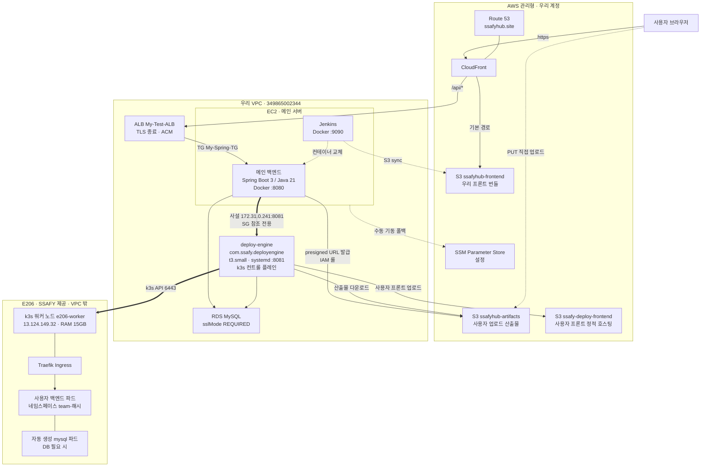
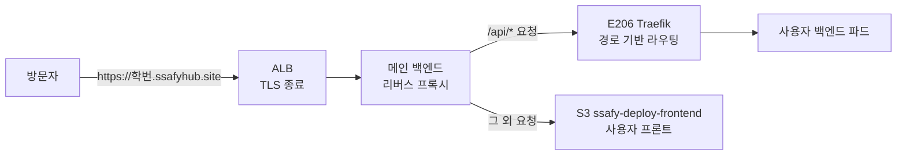
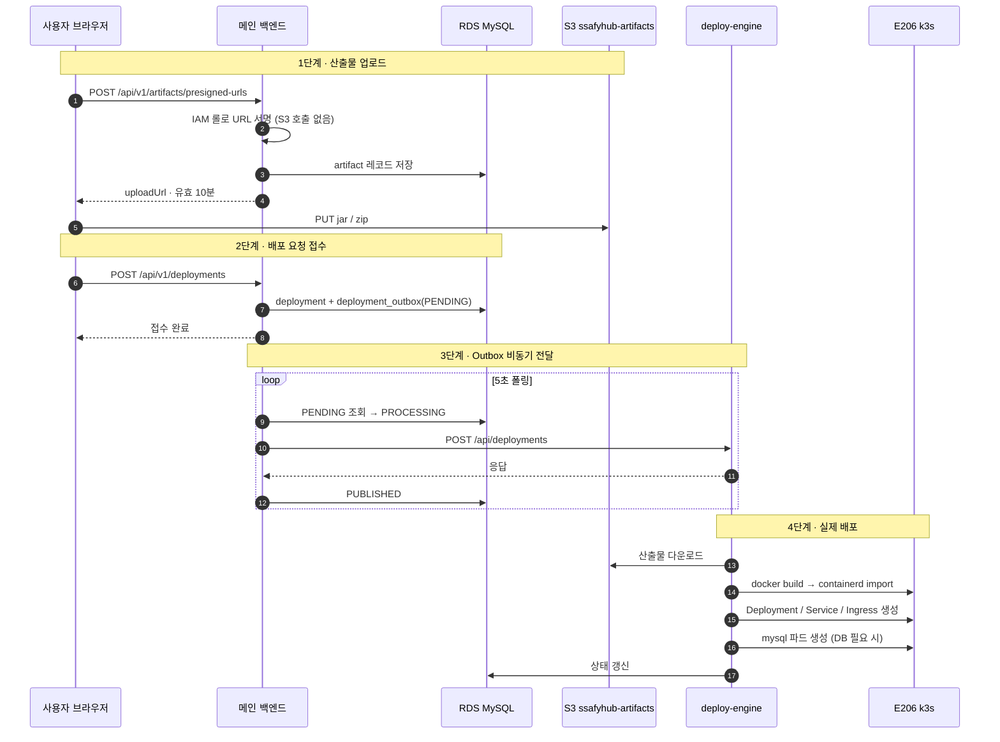
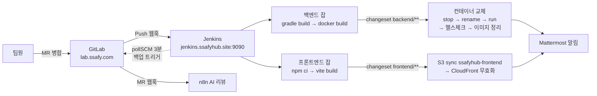
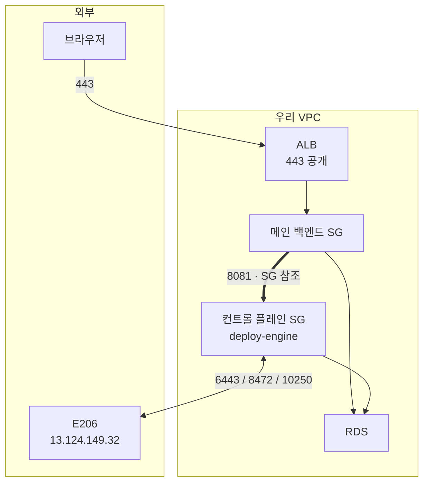

# SSAFYHUB 아키텍처

사용자가 빌드 산출물(`.jar` / `.zip`)을 올리면 자동으로 배포해 공개 URL을 발급하는 서비스다.
배포 오케스트레이션은 우리가 만든 `deploy-engine`이 담당하고, 사용자 앱은 k3s 클러스터에서 실행된다.

문서는 네 장으로 나눠 그린다. 한 장에 모두 담으면 읽는 사람의 질문마다 다른 부분을 봐야 해서
오히려 이해가 어려워진다.

| 그림 | 답하는 질문 |
|---|---|
| [① 시스템 구성도](#-시스템-구성도) | 무엇이 어디에 있고 경계는 어디인가 |
| [② 사용자 서비스 접속 경로](#-사용자-서비스-접속-경로) | 배포된 앱에 방문자가 어떻게 도달하는가 |
| [③ 배포 처리 흐름](#-배포-처리-흐름) | 업로드부터 파드 생성까지 무슨 일이 일어나는가 |
| [④ CI/CD 파이프라인](#-cicd-파이프라인) | 우리 코드가 어떻게 프로덕션에 도달하는가 |

## 경계

| 구성요소 | 경계 |
|---|---|
| 메인 백엔드, deploy-engine, ALB, RDS | **우리 시스템** — 우리 VPC / 계정 `349865002344` |
| CloudFront, S3, Route 53, ACM, SSM | **AWS 관리형** — 우리 계정 리소스 |
| E206 (`i15e206.p.ssafy.io`) | **외부** — SSAFY 제공, 우리 VPC 밖. 단 우리 k3s 워커 노드로 조인 |
| 사용자 브라우저 / 방문자 | 외부 |

## ① 시스템 구성도

굵은 화살표가 이 시스템의 핵심 경로다. 메인 백엔드는 배포를 직접 수행하지 않고
`deploy-engine`에 위임하며, 실제 실행은 VPC 밖 E206에서 일어난다.

## ② 사용자 서비스 접속 경로

배포된 사용자 앱은 서브도메인으로 공개되지만, 실행 위치는 VPC 밖이다.
**메인 백엔드가 리버스 프록시 역할을 겸해** 이 간극을 메운다.

| 구분 | 주소 |
|---|---|
| 외부 공개 | `https://{학번}.ssafyhub.site` |
| 내부 실제 경로 | `http://13.124.149.32:443/team-{해시}/{slug}` |

`slug`는 학번이며, `deployment.public-domain` 설정값(`ssafyhub.site`)과 조합해 공개 URL을 만든다.
내부 주소는 경로 기반이므로 파드가 재생성돼도 외부 URL은 유지된다.

## ③ 배포 처리 흐름

산출물은 백엔드를 경유하지 않고 브라우저에서 S3로 직접 올라간다.
배포 요청은 Outbox 테이블을 거쳐 비동기로 `deploy-engine`에 전달된다.

**presigned URL 발급은 S3를 호출하지 않는다.** 로컬에서 서명만 계산하므로 자격증명이 잘못돼도
발급은 성공하고, 실패는 브라우저의 `PUT` 단계에서 드러난다. 검증할 때 발급 응답만 보면 안 된다.

**Outbox는 현재 재시도가 없다.** 전송 실패 시 `FAILED`로 종결되고, 처리 중 프로세스가 죽으면
`PROCESSING`에서 정체된다. 개선 과제로 남아 있다.

## ④ CI/CD 파이프라인

우리 프로젝트 자체의 배포 경로다. `main` 브랜치만 배포 대상이며, 모노레포이므로 각 잡은
자기 디렉터리 변경에만 반응한다.

| 잡 | 트리거 | 배포 대상 | 산출물 |
|---|---|---|---|
| 백엔드 | 웹훅 + `pollSCM` 3분 | `main` | EC2 Docker 컨테이너 `:8080` |
| 프론트엔드 | 웹훅 | `main` | S3 `ssafyhub-frontend` + CloudFront |

배포가 어느 단계에서 실패하거나 중단되더라도 `trap`으로 직전 컨테이너를 되살린다.
자세한 배경은 [장애 기록](./cicd-incident-2026-07-29.md)에 있다.

## 네트워크와 보안

- **`deploy-engine`은 공인망에 노출되지 않는다.** 공인 IP(`54.116.87.72`)가 있지만
  `8081` 접근은 **보안그룹 참조**(메인 백엔드 SG → 컨트롤 플레인 SG)로만 허용한다.
  IP 대역이 아니라 SG를 대상으로 지정하므로 인스턴스가 교체돼도 규칙이 유지된다.
- **E206은 VPC 밖이라 공인 IP로 연결한다.** k3s API `6443`, VXLAN `8472`, kubelet `10250`.
- RDS는 메인 백엔드와 `deploy-engine`이 공유한다.

### 포트 정리

| 포트 | 위치 | 용도 | 노출 |
|---|---|---|---|
| 443 | ALB | 사용자 트래픽 (TLS) | 공개 |
| 8080 | 메인 EC2 | 메인 백엔드 | ALB 경유 |
| 8081 | 컨트롤 플레인 EC2 | deploy-engine | SG 참조 전용 |
| 9090 | 메인 EC2 | Jenkins | 제한 권장 (과제) |
| 50000 | 메인 EC2 | Jenkins 에이전트 | 미사용 |
| 6443 / 8472 / 10250 | 컨트롤 플레인 ↔ E206 | k3s 클러스터 통신 | 상호 |

## 기술 스택

| 영역 | 사용 기술 |
|---|---|
| 프론트엔드 | Vue 3, Vite, Pinia, Axios |
| 메인 백엔드 | Spring Boot 3, Java 21, Spring Security, JPA, Gradle |
| 배포 오케스트레이터 | Spring Boot (`com.ssafy.deployengine`), k3s API |
| 사용자 앱 런타임 | k3s, containerd, Traefik |
| 데이터 | RDS MySQL, S3 |
| CI/CD | Jenkins Multibranch Pipeline, GitLab 웹훅, Mattermost, n8n |
| 인증 | JWT 액세스·리프레시 쿠키, CSRF (`XSRF-TOKEN` + `X-XSRF-TOKEN`) |

## 그림을 고칠 때

이 문서의 다이어그램은 모두 Mermaid이며 GitLab이 그대로 렌더링한다.
텍스트이므로 diff 리뷰가 되고, 코드와 함께 버전 관리된다.
발표 슬라이드용으로 다듬을 때만 draw.io 등으로 다시 그리면 된다.

`docs/` 아래 변경은 `backend/**`도 `frontend/**`도 아니므로 **배포를 유발하지 않는다.**
