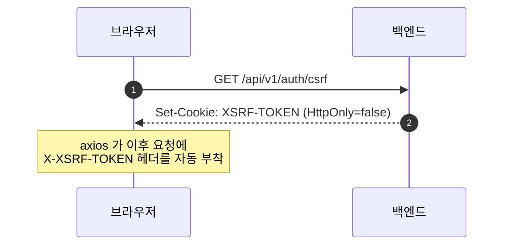
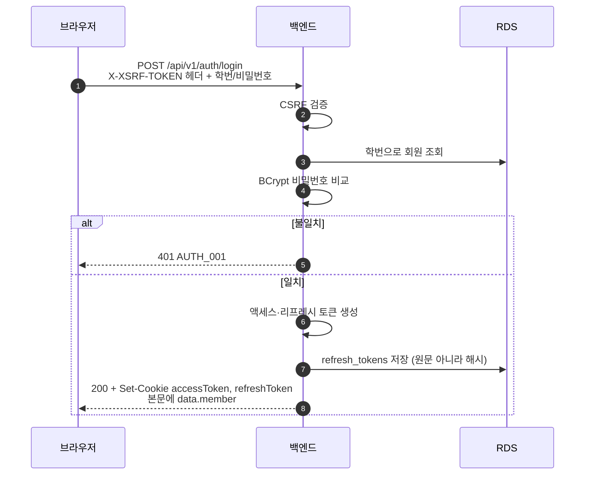
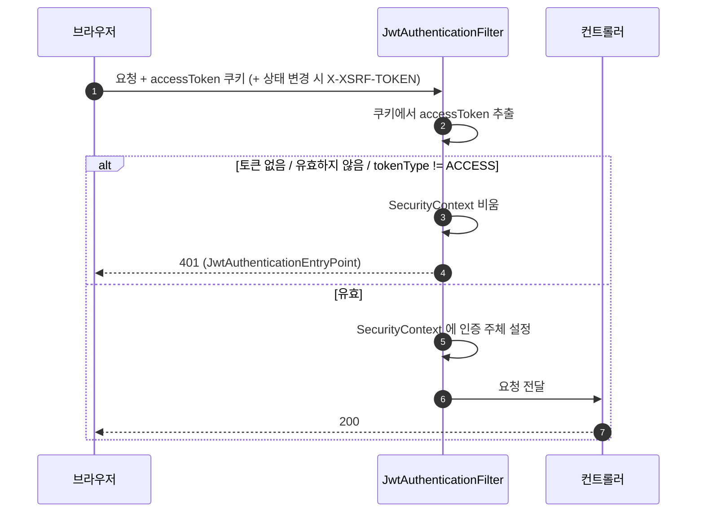
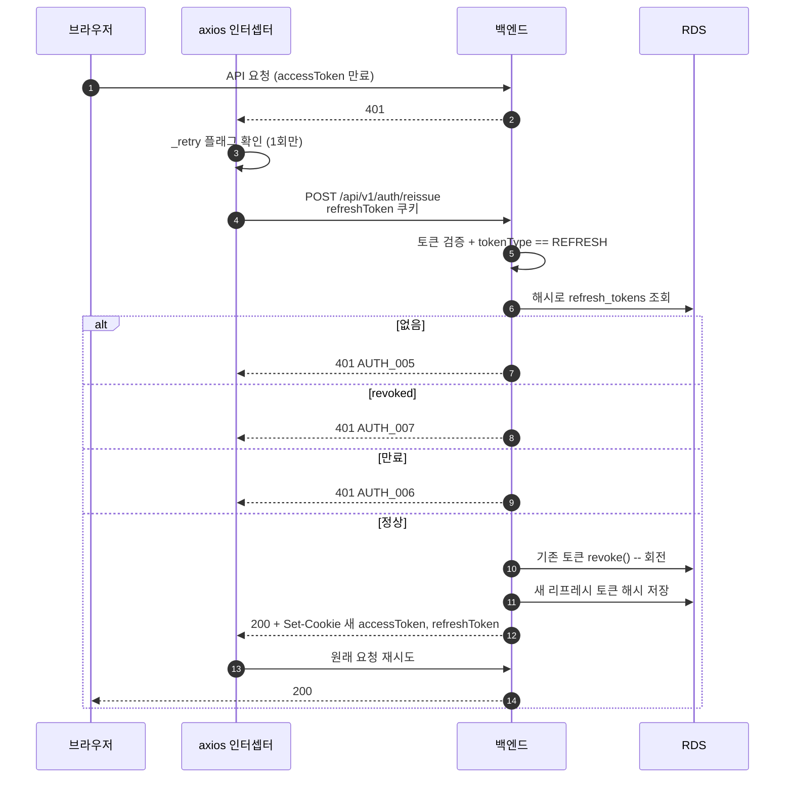
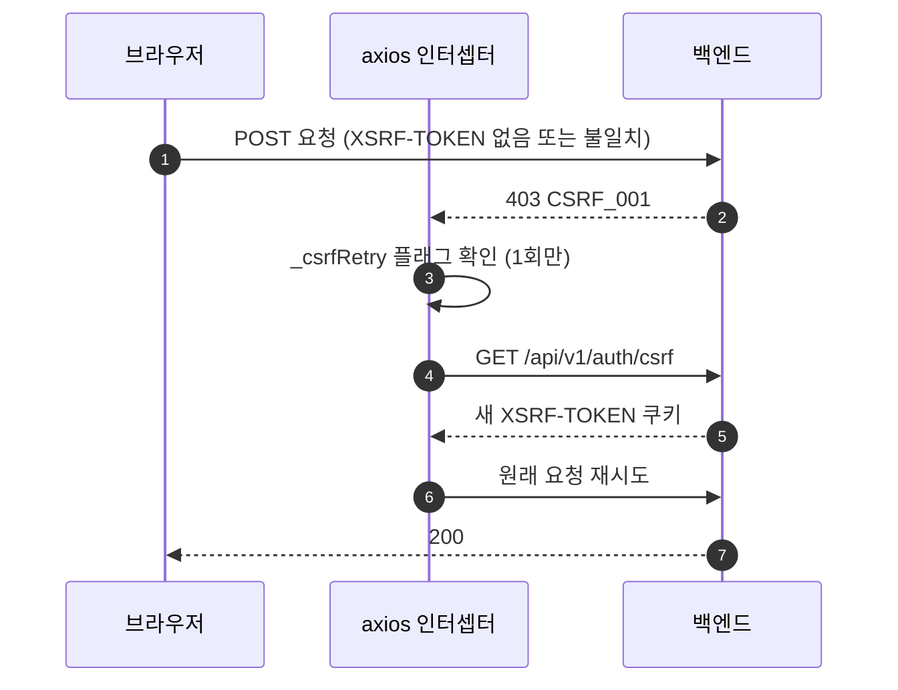

# 인증 흐름

쿠키 기반 JWT + CSRF 이중 구조다. 토큰을 자바스크립트에 노출하지 않으면서
CSRF 공격을 막기 위한 조합이며, 그만큼 주의할 지점이 많다.

구현 위치는 `WebSecurityConfig`, `JwtAuthenticationFilter`, `AuthService`, `CookieUtil`,
그리고 프론트엔드의 `src/api/client.js`다.

## 쿠키 3종

| 쿠키 | HttpOnly | Path | 용도 |
|---|:---:|---|---|
| `accessToken` | **true** | `/` | 모든 인증 요청. 만료 30분 |
| `refreshToken` | **true** | **`/api/v1/auth`** | 액세스 토큰 재발급 전용. 만료 14일 |
| `XSRF-TOKEN` | **false** | `/` | 자바스크립트가 읽어 헤더에 실어야 하므로 `false` |

공통 속성: `SameSite=Lax`, `Secure`는 프로파일에 따름 (`security.cookie.secure` — 프로덕션 `true`, 로컬 `false`).

두 가지 설계 의도가 있다.

- **토큰 쿠키는 `HttpOnly`**여서 XSS로 탈취할 수 없다. 그래서 프론트엔드는 토큰을 저장하지도, 읽지도 않는다.
- **리프레시 토큰의 Path가 `/api/v1/auth`로 좁다.** 일반 API 요청에는 아예 전송되지 않아
  노출 면적이 줄어든다.

`XSRF-TOKEN`만 `HttpOnly=false`인 이유는 이중 제출(double submit) 방식이기 때문이다.
쿠키의 값과 헤더의 값이 일치해야 통과하며, 다른 사이트는 쿠키를 읽을 수 없으므로 헤더를 만들 수 없다.

## 세션 없는 검증

```
sessionManagement → SessionCreationPolicy.STATELESS
addFilterBefore(jwtAuthenticationFilter, UsernamePasswordAuthenticationFilter.class)
```

`JwtAuthenticationFilter`가 요청마다 `accessToken` 쿠키를 읽어 검증하고 `SecurityContext`를 채운다.
서버는 세션을 만들지 않는다.

필터는 **토큰 타입까지 확인한다** — `tokenType` 클레임이 `ACCESS`가 아니면 거부한다.
리프레시 토큰을 액세스 토큰 자리에 넣어 쓰는 것을 막는다.

## 1. 앱 시작 — CSRF 토큰 확보



프론트엔드는 axios 설정만으로 처리한다.

```js
withCredentials: true,
withXSRFToken: true,
xsrfCookieName: "XSRF-TOKEN",
xsrfHeaderName: "X-XSRF-TOKEN",
```

`withXSRFToken: true`를 **명시**한 이유가 있다. axios는 기본적으로 same-origin으로 판정된 요청에만
XSRF 헤더를 붙이는데, 그 판정에 의존하면 환경에 따라 헤더가 빠질 수 있다. 명시하면 항상 붙는다.

## 2. 로그인



**리프레시 토큰은 해시로 저장한다** (`TokenHasher`). DB가 유출돼도 토큰을 재사용할 수 없다.

응답 본문에는 회원 정보(`memberId`, `name`, `studentNumber`, `teamName`, `role`)만 담긴다.
토큰은 쿠키로만 전달된다.

> **로그인 직후 CSRF 토큰을 다시 받아야 한다.** 인증 주체가 바뀌면 기존 CSRF 토큰이 무효가 될 수 있다.
> 이 문제로 `205863d fix: 로그인 후 CSRF 토큰 재발급` 수정이 있었다.

## 3. 인증된 요청



`GET`은 CSRF 검증 대상이 아니다. `POST` / `PATCH` / `DELETE`만 헤더가 필요하다.

## 4. 액세스 토큰 만료 — 재발급과 회전



### 리프레시 토큰 회전

재발급 시 **기존 토큰을 폐기(`revoke()`)하고 새 토큰을 발급한다.** 한 번 쓴 리프레시 토큰은
다시 쓸 수 없다.

폐기된 토큰이 다시 들어오면 `AUTH_007 REVOKED_REFRESH_TOKEN`으로 구분된다. 단순히 "유효하지 않음"이
아니라 **탈취 가능성의 신호**로 읽을 수 있다.

### 재발급 동시 실행 방지

여러 요청이 동시에 401을 받으면 재발급이 여러 번 일어나고, 회전 때문에 뒤늦은 요청이
폐기된 토큰을 쓰게 된다. 프론트엔드는 공유 프로미스로 이를 막는다.

```js
let reissuePromise = null;
// ...
if (!reissuePromise) {
  reissuePromise = apiClient.post("/api/v1/auth/reissue");
}
await reissuePromise;
```

첫 요청만 실제로 재발급하고 나머지는 그 결과를 기다린다. 완료 후 `reissuePromise`를 `null`로 되돌린다.

### 무한 루프 차단

- `_retry` 플래그로 요청당 재시도를 **1회**로 제한한다
- **재발급 요청 자체가 401이면 재시도하지 않는다** (`isReissueRequest` 검사). 이 검사가 없으면
  재발급 실패 시 무한 루프에 빠진다
- 로그인 요청의 401도 재시도 대상에서 제외한다 (비밀번호 오류는 재발급으로 해결되지 않는다)

## 5. CSRF 실패 복구



이 경로가 없으면 CSRF 토큰이 한 번 어긋난 순간부터 **페이지를 새로고침할 때까지 모든 상태 변경
요청이 403으로 실패한다.** 앱 시작 시 CSRF 발급 요청은 `await`하지 않고 실패도 무시하므로,
백엔드 순단이나 쿠키 소실로 토큰이 없는 상태가 그대로 유지될 수 있었다.

`7c5916e fix: CSRF 토큰 누락 시 403 실패 복구`에서 추가된 경로다.

## 인증 에러 코드

| 코드 | 상태 | 의미 | 대응 |
|---|---|---|---|
| `AUTH_001` | 401 | 학번 또는 비밀번호 불일치 | 사용자에게 안내 |
| `AUTH_002` | 401 | 유효하지 않은 토큰 | 재로그인 |
| `AUTH_003` | 401 | 만료된 액세스 토큰 | 인터셉터가 재발급 |
| `AUTH_004` | 401 | 리프레시 토큰 없음 | 재로그인 |
| `AUTH_005` | 401 | 유효하지 않은 리프레시 토큰 | 재로그인 |
| `AUTH_006` | 401 | 만료된 리프레시 토큰 | 재로그인 |
| `AUTH_007` | 401 | **폐기된** 리프레시 토큰 | 재로그인. 탈취 의심 신호 |
| `CSRF_001` | 403 | CSRF 토큰 없음·불일치 | 인터셉터가 재발급 후 1회 재시도 |

## 인증이 필요 없는 경로

`WebSecurityConfig`의 `permitAll` 목록이다. 그 외 모든 요청은 `authenticated()`다.

| 메서드 | 경로 |
|---|---|
| POST | `/api/v1/members/signup` |
| POST | `/api/v1/auth/login` |
| POST | `/api/v1/auth/reissue` |
| GET | `/api/v1/auth/csrf` |
| GET | `/api/v1/showcase/public` |
| GET | `/api/v1/showcase/*` |
| GET | `/actuator/health` |
| — | `/swagger-ui/**`, `/v3/api-docs/**` |

> `/actuator/health`는 **`GET`만** 열려 있다. `HEAD`로 요청하면 401이 난다.
> ALB 헬스체크를 `HEAD`로 바꾸면 대상그룹이 전부 unhealthy가 된다.

## 주의할 점

### 로컬에서 재현되지 않는 문제가 있다

`security.cookie.secure`가 프로덕션은 `true`, 로컬은 `false`다. `Secure` 쿠키는 HTTPS에서만
전송되므로, **쿠키 관련 문제는 로컬에서 정상 동작하고 배포 환경에서만 터질 수 있다.**

배포 전 검증은 실제 HTTPS 환경에서 해야 한다.

### `JWT_SECRET`을 바꾸면 전원 로그아웃된다

서명 키가 바뀌면 기존 토큰이 모두 검증에 실패한다. Jenkins 크리덴셜과 수동 기동 설정의 값이
다르면 **배포 방식을 바꿀 때마다** 로그아웃이 발생한다. 두 곳을 반드시 일치시킨다.

### CSRF 토큰은 `HttpOnly`가 아니어야 한다

`CookieCsrfTokenRepository.withHttpOnlyFalse()`를 쓰는 이유다. `HttpOnly=true`로 바꾸면
자바스크립트가 읽을 수 없어 헤더를 만들 수 없고, 모든 상태 변경 요청이 403이 된다.

토큰 값 자체는 비밀이 아니다. 다른 오리진이 **읽을 수 없다는 점**이 방어의 근거다.

## 확인 명령

```bash
curl -s -i http://localhost:8080/api/v1/auth/csrf | grep -i set-cookie
```

`XSRF-TOKEN`이 내려오고 `HttpOnly`가 붙어 있지 **않아야** 한다.

전체 흐름을 셸에서 확인하려면 쿠키 항아리를 쓴다.

```bash
J=/tmp/c.txt; rm -f $J
curl -sS -c $J http://localhost:8080/api/v1/auth/csrf -o /dev/null
CSRF=$(awk '$6=="XSRF-TOKEN"{print $7}' $J)
curl -sS -b $J -c $J -X POST http://localhost:8080/api/v1/auth/login \
  -H 'Content-Type: application/json' -H "X-XSRF-TOKEN: $CSRF" \
  -d '{"studentNumber":"<학번>","password":"<비밀번호>"}'
```

## 관련 문서

| 문서 | 내용 |
|---|---|
| [API 명세서](./api-spec.md) | 엔드포인트별 인증·CSRF 필요 여부 |
| [ERD](./erd.md) | `members`, `refresh_tokens` 테이블 |
| [운영 런북](./runbook.md) | 인증·CSRF 문제 대응 |
| [트러블슈팅](./troubleshooting.md) | 실제 발생했던 CSRF 사례 |
