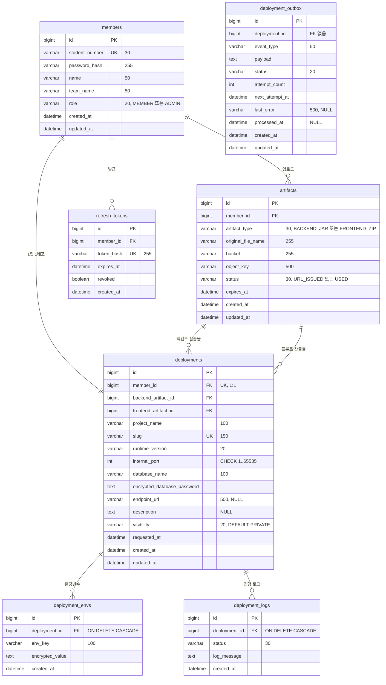
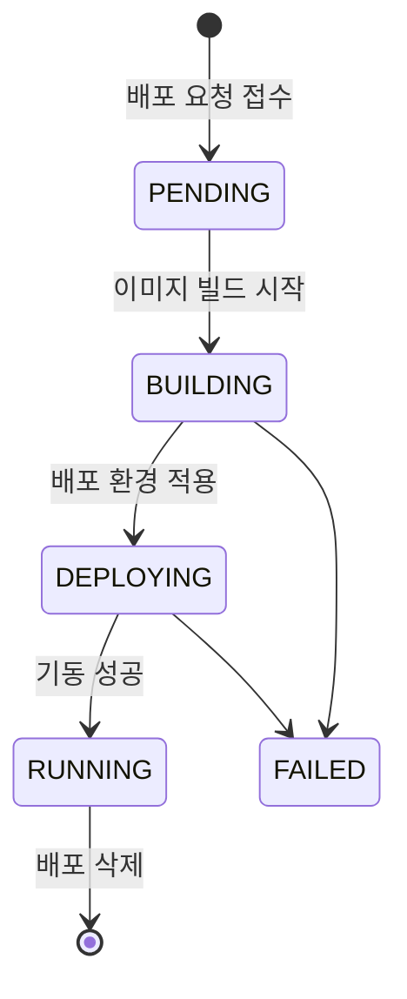
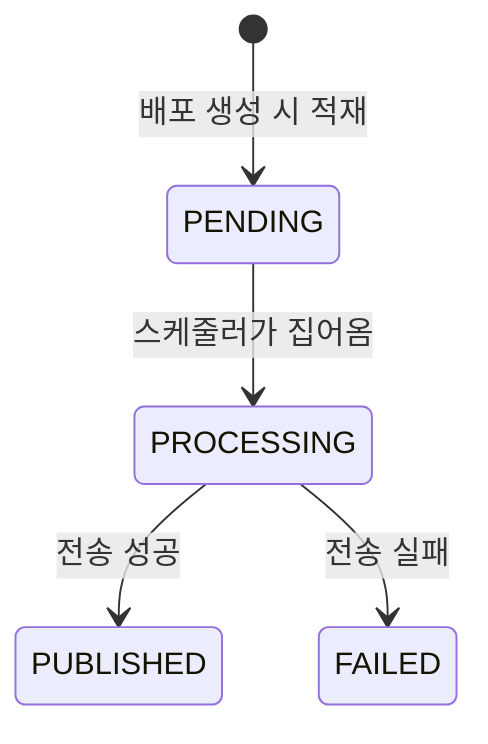

# 데이터베이스 설계서 (ERD)

JPA 엔티티 정의에서 직접 추출했다. 테이블 7개, MySQL 8, `sslMode=REQUIRED`.

스키마는 `JPA_DDL_AUTO`(프로덕션 기본 `update`)로 엔티티에서 생성된다.
따라서 **엔티티 코드가 스키마의 유일한 원본**이며, 이 문서는 그것을 읽기 쉽게 옮긴 것이다.

## 관계도



`deployment_outbox`는 관계선이 없다. 아래 [설계 결정](#설계-결정)에서 이유를 설명한다.

## 테이블 상세

### `members`

| 컬럼 | 타입 | 제약 | 설명 |
|---|---|---|---|
| `id` | BIGINT | PK, AUTO_INCREMENT | |
| `student_number` | VARCHAR(30) | NOT NULL, UNIQUE | 학번. 로그인 아이디 |
| `password_hash` | VARCHAR(255) | NOT NULL | BCrypt 해시 |
| `name` | VARCHAR(50) | NOT NULL | 이름 |
| `team_name` | VARCHAR(50) | NOT NULL | 팀명 |
| `role` | VARCHAR(20) | NOT NULL | `MEMBER` / `ADMIN` |
| `created_at` | DATETIME | NOT NULL, 수정불가 | |
| `updated_at` | DATETIME | NOT NULL | |

**제약** `uk_members_student_number (student_number)`

학번 중복은 이 유니크 제약으로 막고, 애플리케이션은 `409 MEMBER_001`로 변환한다.

### `artifacts`

사용자가 업로드하는 배포 산출물(`.jar` / `.zip`)의 메타데이터. 파일 자체는 S3에 있다.

| 컬럼 | 타입 | 제약 | 설명 |
|---|---|---|---|
| `id` | BIGINT | PK | |
| `member_id` | BIGINT | NOT NULL, FK | 업로드한 회원 |
| `artifact_type` | VARCHAR(30) | NOT NULL | `BACKEND_JAR` / `FRONTEND_ZIP` |
| `original_file_name` | VARCHAR(255) | NOT NULL | 사용자가 올린 원본 파일명 |
| `bucket` | VARCHAR(255) | NOT NULL | S3 버킷 (`ssafyhub-artifacts`) |
| `object_key` | VARCHAR(500) | NOT NULL | `artifacts/{memberId}/{UUID}/{backend\|frontend}/{파일명}` |
| `status` | VARCHAR(30) | NOT NULL | `URL_ISSUED` → `USED` |
| `expires_at` | DATETIME | NOT NULL | Presigned URL 만료 시각 (발급 후 10분) |
| `created_at` / `updated_at` | DATETIME | NOT NULL | |

**제약**
- `fk_artifacts_member (member_id)` → `members.id`
- `CHECK artifact_type IN ('BACKEND_JAR','FRONTEND_ZIP') AND status IN ('URL_ISSUED','USED')`

`status`가 `USED`가 되면 재사용할 수 없다 → `409 ARTIFACT_008`.

### `deployments`

| 컬럼 | 타입 | 제약 | 설명 |
|---|---|---|---|
| `id` | BIGINT | PK | |
| `member_id` | BIGINT | NOT NULL, **UNIQUE**, FK | **1인 1배포** |
| `backend_artifact_id` | BIGINT | NOT NULL, FK, INDEX | |
| `frontend_artifact_id` | BIGINT | NOT NULL, FK, INDEX | |
| `project_name` | VARCHAR(100) | NOT NULL | |
| `slug` | VARCHAR(150) | NOT NULL, UNIQUE | 공개 URL의 서브도메인 (학번) |
| `runtime_version` | VARCHAR(20) | NOT NULL | Java 버전. 허용값은 `SUPPORTED_RUNTIME_VERSIONS` |
| `internal_port` | INT | NOT NULL, CHECK | 앱 내부 포트 |
| `database_name` | VARCHAR(100) | NOT NULL | 자동 생성 DB 이름 |
| `encrypted_database_password` | TEXT | NOT NULL | **암호화 저장** |
| `endpoint_url` | VARCHAR(500) | NULL | 배포 완료 후 채워짐 |
| `description` | TEXT | NULL | 쇼케이스 설명 |
| `visibility` | VARCHAR(20) | NOT NULL, DEFAULT `PRIVATE` | `PUBLIC` / `PRIVATE` |
| `requested_at` | DATETIME | NOT NULL, 수정불가 | 배포 요청 시각 |
| `created_at` / `updated_at` | DATETIME | NOT NULL | |

**제약**
- `uk_deployments_member_id (member_id)` — 위반 시 `409 DEPLOYMENT_001`
- `uk_deployments_slug (slug)`
- `fk_deployments_member`, `fk_deployments_backend_artifact`, `fk_deployments_frontend_artifact`
- `idx_deployments_backend_artifact_id`, `idx_deployments_frontend_artifact_id`
- `CHECK internal_port BETWEEN 1 AND 65535 AND visibility IN ('PUBLIC','PRIVATE')`

**`status` 컬럼이 없다.** [설계 결정](#현재-상태를-저장하지-않는다) 참고.

### `deployment_envs`

| 컬럼 | 타입 | 제약 | 설명 |
|---|---|---|---|
| `id` | BIGINT | PK | |
| `deployment_id` | BIGINT | NOT NULL, FK, **CASCADE** | |
| `env_key` | VARCHAR(100) | NOT NULL | 대문자로 시작, 대문자/숫자/언더스코어 |
| `encrypted_value` | TEXT | NOT NULL | **암호화 저장** |
| `created_at` | DATETIME | NOT NULL | |

**제약**
- `uk_deployment_envs_key (deployment_id, env_key)` — 같은 배포 내 중복 키 차단 → `400 DEPLOYMENT_003`
- `fk_deployment_envs_deployment` + `ON DELETE CASCADE`

### `deployment_logs`

배포 진행 로그. `GET /api/v1/deployments/{id}/logs`가 이 테이블을 읽는다.

| 컬럼 | 타입 | 제약 | 설명 |
|---|---|---|---|
| `id` | BIGINT | PK | |
| `deployment_id` | BIGINT | NOT NULL, FK, **CASCADE** | |
| `status` | VARCHAR(30) | NOT NULL | 그 시점의 배포 상태 |
| `log_message` | TEXT | NOT NULL | 로그 한 줄 |
| `created_at` | DATETIME | NOT NULL | |

**제약**
- `idx_deployment_logs_latest (deployment_id, id DESC)`
- `CHECK status IN ('PENDING','BUILDING','DEPLOYING','RUNNING','FAILED')`

인덱스가 `id DESC`인 이유는 **최신 1건 조회가 뜨거운 쿼리**이기 때문이다. 배포 상태를 이 테이블에서
파생하므로 상태 조회마다 이 인덱스를 탄다.

### `deployment_outbox`

배포 요청을 `deploy-engine`에 비동기 전달하기 위한 Outbox 테이블.

| 컬럼 | 타입 | 제약 | 설명 |
|---|---|---|---|
| `id` | BIGINT | PK | |
| `deployment_id` | BIGINT | NOT NULL | **FK 없음** (아래 설명) |
| `event_type` | VARCHAR(50) | NOT NULL | 현재 `DEPLOYMENT_REQUESTED` 하나 |
| `payload` | TEXT | NOT NULL | 전송 본문 |
| `status` | VARCHAR(20) | NOT NULL | `PENDING` → `PROCESSING` → `PUBLISHED` / `FAILED` |
| `attempt_count` | INT | NOT NULL | 시도 횟수 |
| `next_attempt_at` | DATETIME | NOT NULL | 이 시각 이후에만 집어온다 |
| `last_error` | VARCHAR(500) | NULL | 실패 요약 (500자로 절단) |
| `processed_at` | DATETIME | NULL | 종결 시각 |
| `created_at` / `updated_at` | DATETIME | NOT NULL | |

**제약**
- `uk_deployment_outbox_event (deployment_id, event_type)` — 같은 이벤트 중복 적재 차단
- `idx_deployment_outbox_pending (status, next_attempt_at)` — 폴링 쿼리 전용 인덱스

### `refresh_tokens`

| 컬럼 | 타입 | 제약 | 설명 |
|---|---|---|---|
| `id` | BIGINT | PK | |
| `member_id` | BIGINT | NOT NULL, FK, INDEX | |
| `token_hash` | VARCHAR(255) | NOT NULL, UNIQUE | **원문이 아니라 해시** |
| `expires_at` | DATETIME | NOT NULL | |
| `revoked` | BOOLEAN | NOT NULL | 폐기 여부 |
| `created_at` | DATETIME | NOT NULL | |

**제약** `uk_refresh_tokens_token_hash`, `idx_refresh_tokens_member_id`, `fk_refresh_tokens_member`

리프레시 토큰을 해시로만 저장하므로 DB가 유출돼도 토큰을 재사용할 수 없다.
상태별로 `AUTH_004`(없음) / `AUTH_005`(유효하지 않음) / `AUTH_006`(만료) / `AUTH_007`(폐기)를 구분한다.

## 설계 결정

### 현재 상태를 저장하지 않는다

`deployments`에 `status` 컬럼이 없다. 현재 상태는 **`deployment_logs`의 최신 행에서 파생**한다.

```java
// DeploymentStatusResponse.of(deployment, latestLog, accessUrl)
latestLog.getStatus()
latestLog.getStatus().displayStatus()
```

- **장점** 상태와 그 이유(로그 메시지)가 항상 같은 행에 있어 불일치가 생기지 않는다.
  상태 변경 이력이 자동으로 남는다.
- **비용** 상태 조회마다 최신 로그를 찾아야 한다. `idx_deployment_logs_latest (deployment_id, id DESC)`가
  이 비용을 감당한다.

스키마만 보고 "상태 컬럼이 빠졌다"고 판단해 추가하면 두 곳이 어긋날 수 있다.

### Outbox에는 FK를 걸지 않았다

`deployment_outbox.deployment_id`는 `Long` 원시값이며 FK가 없다. Outbox는 도메인 테이블과
수명주기를 분리해야 하기 때문이다. 배포가 삭제돼도 전송 이력은 남아야 하고, 반대로 Outbox 적재
실패가 배포 트랜잭션을 막아서도 안 된다.

### 민감 값은 암호화해 저장한다

`encrypted_database_password`(`deployments`)와 `encrypted_value`(`deployment_envs`)는
`SECRET_ENCRYPTION_KEY`로 암호화한다. **이 키를 바꾸면 기존 데이터를 복호화할 수 없다.**

### 사용자당 배포는 하나

`uk_deployments_member_id`가 이를 스키마 수준에서 보장한다. 그래서
`GET /api/v1/deployments`가 목록이 아니라 단건을 반환한다.

## 상태 전이

### 배포 상태 (`DeploymentStatus`)



| 값 | 화면 표시 |
|---|---|
| `PENDING` | 배포 대기 중 |
| `BUILDING` | 이미지 빌드 중 |
| `DEPLOYING` | 배포 환경에 적용 중 |
| `RUNNING` | 정상 기동 |
| `FAILED` | 배포 실패 |

### Outbox 상태 (`OutboxStatus`)



**`FAILED`와 `PROCESSING`은 종착지다.** 스케줄러는 `PENDING`만 집어오므로 재시도가 없고,
`PROCESSING` 중에 프로세스가 죽으면 복구되지 않는다. 개선 과제로 남아 있다.

### 산출물 상태 (`ArtifactStatus`)

`URL_ISSUED` (Presigned URL 발급) → `USED` (배포에 사용됨). 되돌아가지 않는다.

## 스키마 확인 방법

```sql
SHOW TABLES;
SHOW CREATE TABLE deployments;
SELECT status, COUNT(*) FROM deployment_outbox GROUP BY status;
```

`JPA_DDL_AUTO=update`는 컬럼 추가만 반영하고 **삭제·타입 변경은 반영하지 않는다.**
엔티티에서 컬럼을 지우면 DB에는 남으므로, 스키마를 정리할 때는 수동 DDL이 필요하다.
