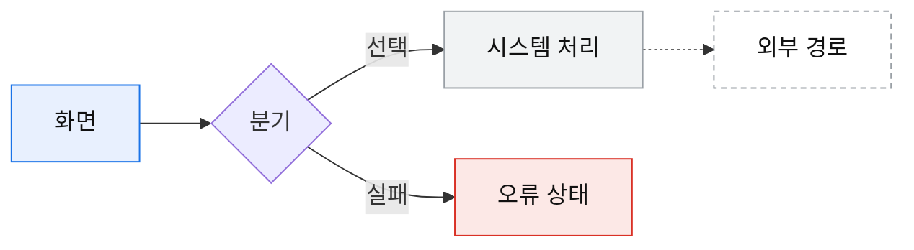
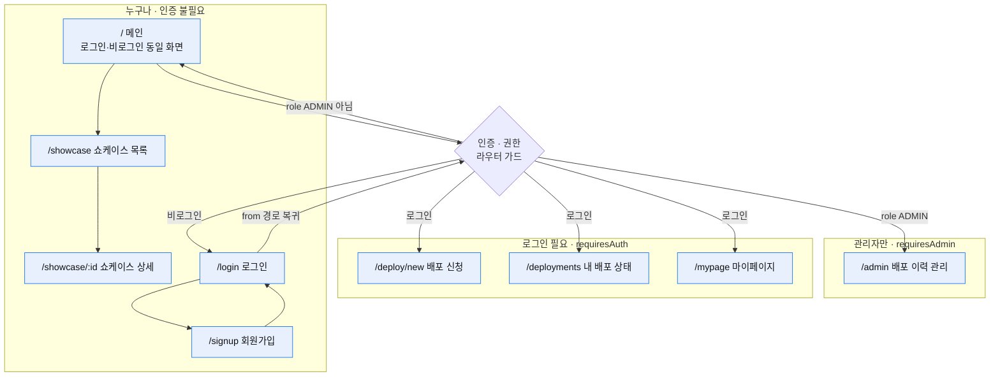
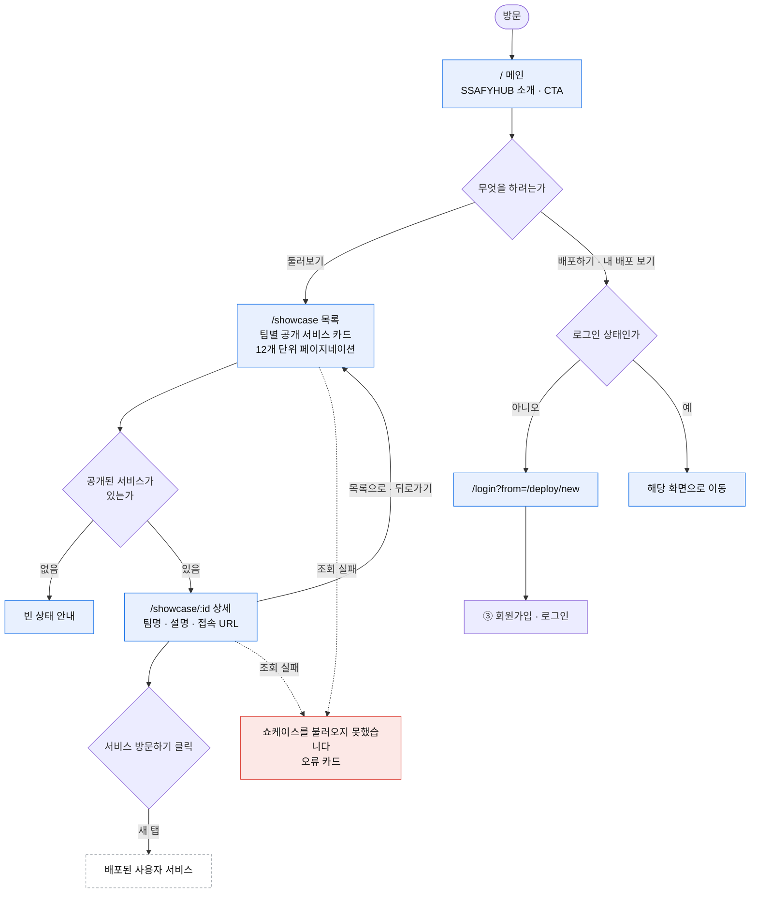
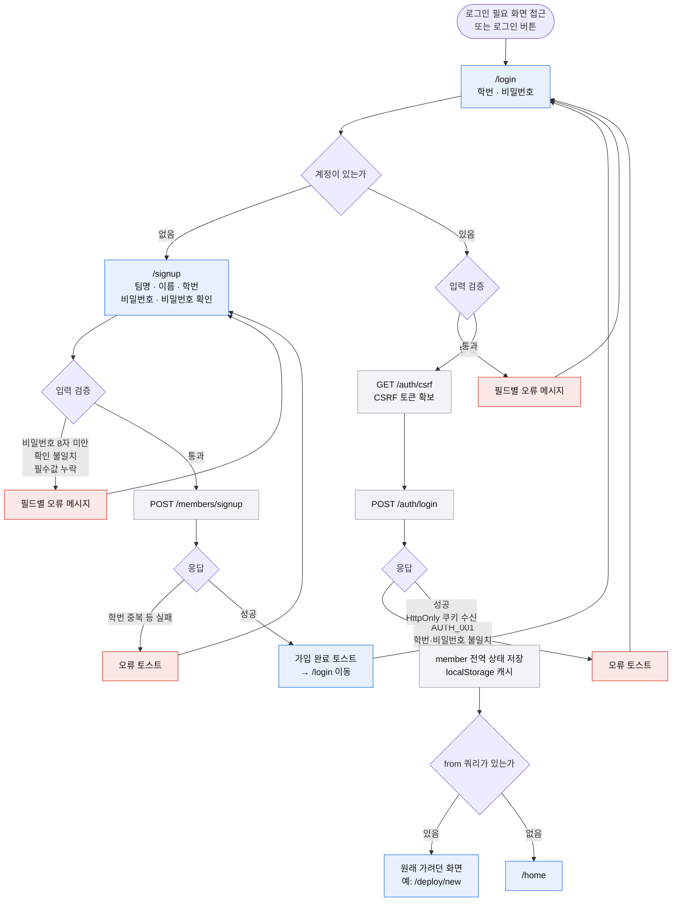
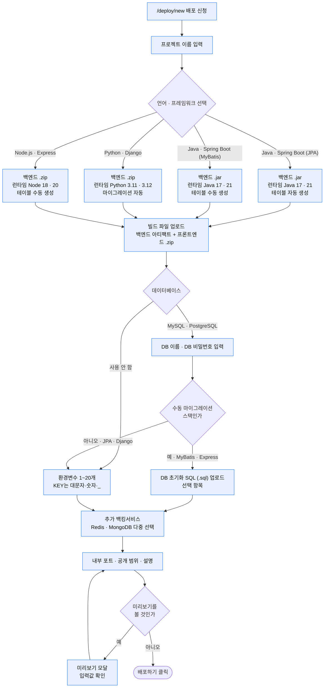
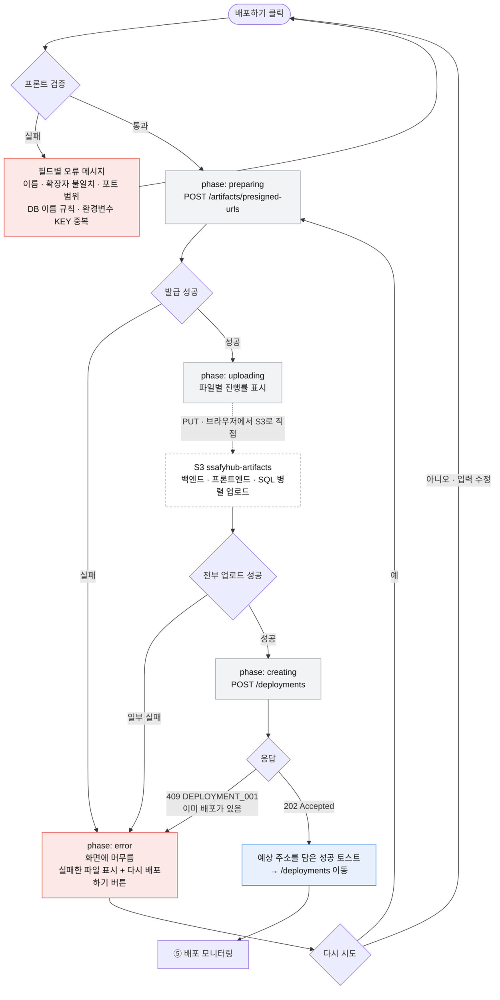
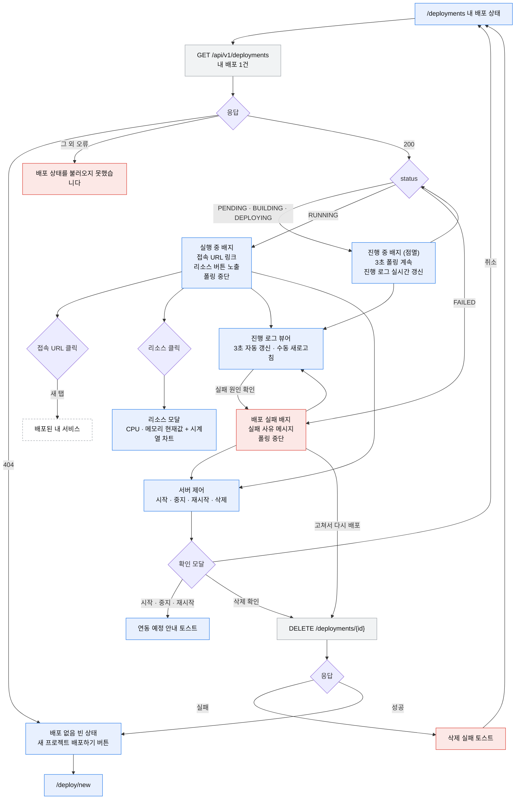

# SSAFYHUB 유저플로우

사용자가 화면에서 무엇을 하고, 그 결과로 어떤 화면에 도달하는지를 그린다.
시스템 내부 구조는 [architecture.md](./architecture.md), API 계약은 [API명세서.md](./API명세서.md),
인증 토큰의 상세 동작은 [auth-flow.md](./auth-flow.md)를 본다.

화면 단위가 아니라 **사용자 목표 단위**로 나눴다. 한 장에 다 담으면 질문마다 다른 부분을
찾아 읽어야 해서 오히려 이해가 어려워진다.

| 그림 | 답하는 질문 |
|---|---|
| [① 화면 지도](#-화면-지도) | 어떤 화면이 있고 누가 들어갈 수 있는가 |
| [② 둘러보기 (비로그인)](#-둘러보기-비로그인) | 처음 온 사람이 무엇을 보고 왜 가입하는가 |
| [③ 회원가입 · 로그인](#-회원가입--로그인) | 계정을 만들고 원래 가려던 화면으로 어떻게 돌아오는가 |
| [④ 배포 신청](#-배포-신청) | 버튼 한 번으로 업로드부터 배포 요청까지 어떻게 이어지는가 |
| [⑤ 배포 모니터링 · 삭제](#-배포-모니터링--삭제) | 요청한 배포가 뜨는지 실패하는지 어떻게 확인하는가 |
| [⑥ 관리자 · 세션 만료](#-관리자--세션-만료) | 관리자는 무엇을 보고, 세션이 끊기면 어떻게 되는가 |

## 표기법

여섯 장 모두 같은 규칙을 쓴다.

| 표기 | 의미 |
|---|---|
| 사각형 (파랑) | 사용자가 보는 화면 · 모달 |
| 다이아몬드 | 분기 — 사용자의 선택 또는 시스템의 판정 |
| 사각형 (회색) | 사용자 조작 없이 도는 시스템 처리 (API 호출, 폴링) |
| 점선 테두리 | 우리 서버를 거치지 않는 경로 (브라우저 → S3 직접 업로드, 배포된 사용자 서비스) |
| 사각형 (빨강) | 실패 · 오류 상태. 여기서 나가는 화살표가 곧 복구 경로다 |

---

## ① 화면 지도

`frontend/src/router.js` 기준. 인증이 필요한 화면에 비로그인 상태로 접근하면
라우터 가드가 `/login?from=<원래경로>`로 보내고, 로그인 성공 후 그 경로로 되돌린다.
헤더 목차(`AppHeader.vue`)도 같은 규칙으로 동작한다 — 쇼케이스만 비로그인에서 바로 열린다.

| 화면 | 경로 | 접근 조건 | 핵심 API |
|---|---|---|---|
| 메인 | `/` | 없음 | 없음 — 저장된 `member`로 이름만 표시 |
| 쇼케이스 목록 | `/showcase` | 없음 | `GET /api/v1/showcase/public` |
| 쇼케이스 상세 | `/showcase/:id` | 없음 | `GET /api/v1/showcase/{id}` |
| 회원가입 | `/signup` | 없음 | `GET /api/v1/auth/csrf` → `POST /api/v1/members/signup` |
| 로그인 | `/login` | 없음 | `GET /api/v1/auth/csrf` → `POST /api/v1/auth/login` |
| 배포 신청 | `/deploy/new` | 로그인 | `POST /api/v1/artifacts/presigned-urls` → `POST /api/v1/deployments` |
| 내 배포 상태 | `/deployments` | 로그인 | `GET /api/v1/deployments` (내 배포 1건), `/{id}/logs`, `/{id}/resources` |
| 마이페이지 | `/mypage` | 로그인 | `GET /api/v1/deployments` |
| 배포 이력 관리 | `/admin` | 로그인 + `ADMIN` | `GET /api/v1/admin/deployments` — **백엔드 미구현** |

"현재 사용자 조회" 엔드포인트는 백엔드에 없다. 로그인 응답의 `member`를 전역 상태와
`localStorage`에 캐시해 그대로 현재 사용자로 쓴다(`api/users.js`). 그래서 이름·역할 표시에는
네트워크 요청이 발생하지 않는다.

`GET /api/v1/deployments`는 목록이 아니라 **로그인한 사용자의 배포 1건**을 돌려준다.
관리자용 전체 목록은 경로가 겹치지 않게 `/api/v1/admin/deployments`로 예약해뒀지만
아직 서버에 없다.

---

## ② 둘러보기 (비로그인)

가입 전에 서비스의 결과물을 먼저 보게 하는 것이 목적이다. 쇼케이스는 로그인 없이 열리고,
**배포와 관련된 행동을 하려는 순간에만** 로그인을 요구한다.

쇼케이스 조회 API는 인증이 필요 없으므로 이 플로우 전체가 비로그인으로 완주된다.
로그인 유도 지점은 **메인 CTA**와 **헤더의 배포 관련 메뉴** 두 곳뿐이다.

쇼케이스 상세에서 할 수 있는 행동은 "서비스 방문하기"와 "목록으로"뿐이다.
남의 서비스를 보고 마음이 움직인 사람을 가입·배포로 잇는 경로가 상세 화면에는 없다 —
헤더나 메인으로 되돌아가야 한다. 유입 관점에서 가장 아쉬운 지점이라 부록에 적어둔다.

---

## ③ 회원가입 · 로그인

가입 직후 자동 로그인은 하지 않는다. 가입 성공 → 토스트 안내 → `/login`으로 이동해
사용자가 직접 로그인한다.

- 토큰은 `HttpOnly` 쿠키로만 오간다. 프론트는 `member` 정보(이름·역할)만 보관한다.
- 로그인 성공 시 CSRF 토큰을 다시 받아야 한다 — 세션 고정 방지로 토큰이 바뀌기 때문이다
  (`auth-flow.md` 2절 참고).
- 로그인 화면에서 취소하고 나가는 경로는 헤더 로고(`/`)뿐이다.

---

## ④ 배포 신청

가장 중요한 플로우다. **선택한 스택이 폼의 나머지를 바꾸고**, 제출 버튼 한 번이
`Presigned URL 발급 → S3 직접 업로드 → 배포 생성` 세 단계를 순차로 돌린다.

### 폼 작성 — 스택이 만드는 분기

Dockerfile은 사용자가 올리지 않는다. 스택 선택값을 보고 플랫폼이 생성한다.
스택을 바꾸면 이미 고른 백엔드 파일과 런타임 버전 선택이 초기화된다 — 요구 확장자가 달라지기 때문이다.

### 제출 — 업로드와 배포 요청

- 파일은 우리 백엔드를 통과하지 않고 브라우저에서 S3로 바로 올라간다. 그래서 진행률·재시도를
  프론트가 직접 관리한다.
- `202 Accepted`는 "요청을 받았다"는 뜻이고 배포가 끝난 게 아니다. 그래서 곧바로
  `/deployments`로 보내 폴링 화면을 띄운다.
- 실패해도 화면을 떠나지 않는다. 마지막 요청 인자를 들고 있어서 재시도 시 폼을 다시 채울 필요가 없다.

---

## ⑤ 배포 모니터링 · 삭제

사용자당 배포는 1개다. 그래서 목록이 아니라 단일 상태 화면이다.
`RUNNING` 또는 `FAILED`에 도달할 때까지 3초마다 갱신하고, 도달하면 폴링을 멈춘다.

상태 전이는 `PENDING → BUILDING → DEPLOYING → RUNNING / FAILED` 한 방향이다.
실패에서 복구하는 유일한 경로는 **삭제 후 재신청**이다 — 사용자당 배포가 1개라
기존 배포를 지우지 않으면 새로 신청할 수 없다.

마이페이지(`/mypage`)는 이 화면의 요약판이다. 같은 `GET /api/v1/deployments`를 써서
프로필과 내 배포 상태 배지를 보여주고 자세히 보기는 `/deployments`로 넘긴다.
로그아웃은 마이페이지와 헤더 두 곳에 있고, 둘 다 쿠키 삭제가 끝난 뒤 `/login`으로 이동한다 —
순서가 뒤바뀌면 다음 화면의 요청이 만료된 쿠키를 들고 나간다.

---

## ⑥ 관리자 · 세션 만료

두 흐름 모두 사용자가 의도한 행동이 아니라 **권한과 세션 상태가 만드는 분기**라서 한 장에 묶었다.

```mermaid
flowchart TB
    subgraph AdminFlow["관리자"]
        A0["로그인 · role ADMIN"] --> A1["헤더에 관리자 메뉴 노출"]
        A1 --> A2["/admin 배포 이력 관리<br/>GET /api/v1/admin/deployments"]
        A2 --> A3{"응답"}
        A3 -->|"현재: 404<br/>백엔드 미구현"| A4["빈 상태 안내<br/>+ 조회 실패 토스트"]
        A3 -->|"구현 후: 200"| A5["전체 배포 테이블<br/>팀 · 프로젝트 · 상태<br/>3초 폴링"]
        A5 --> A6["행 클릭 → 리소스 모달"]
        A7["일반 사용자가 /admin 직접 진입"] --> A8["가드가 /home으로 되돌림"]
    end

    subgraph Session["세션 만료 · 모든 인증 화면 공통"]
        B0["인증이 필요한 요청"] --> B1{"응답"}
        B1 -->|"200"| B2["정상 처리"]
        B1 -->|"401 AUTHENTICATION_REQUIRED"| B3["인터셉터가 재발급<br/>POST /api/v1/auth/reissue"]
        B1 -->|"403 CSRF_001"| B4["CSRF 재발급 후 1회 재시도"]
        B4 --> B0
        B3 --> B5{"재발급 결과"}
        B5 -->|"성공 · 토큰 회전"| B6["원래 요청 자동 재시도"]
        B6 --> B2
        B5 -->|"리프레시 토큰 없음·만료·폐기"| B7["로컬 인증 상태 정리<br/>로그인 만료 토스트"]
        B7 --> B8["/login 재로그인<br/>작성 중이던 입력은 유실"]
    end

    classDef screen fill:#e8f0fe,stroke:#1a73e8,color:#111
    classDef proc fill:#f1f3f4,stroke:#9aa0a6,color:#111
    classDef fail fill:#fce8e6,stroke:#d93025,color:#111
    class A1,A2,A4,A5,A6,A8,B8 screen
    class A0,B0,B2,B3,B4,B6 proc
    class B7 fail
```

- 동시에 여러 요청이 401을 받아도 재발급은 한 번만 실행되고 나머지는 그 결과를 기다린다.
- 재발급 요청 자체와 로그인 요청의 401은 재시도 대상이 아니다 — 무한 루프를 막기 위한 장치다.
- 인터셉터는 401 중 **`code`가 `AUTHENTICATION_REQUIRED`인 경우에만** 재발급한다
  (`api/client.js`). `auth-flow.md`는 `AUTH_003`(만료된 액세스 토큰)도 인터셉터가 재발급한다고
  적고 있어 실제 코드와 어긋난다. 서버가 실제로 어떤 코드를 주는지 확인이 필요하다 — 만약
  `AUTH_003`을 준다면 재발급이 돌지 않고 곧바로 오류로 떨어진다.
- **배포 신청 폼 작성 중 세션이 끊기면 입력이 전부 사라진다.** 현재 임시 저장이 없다.
  개선 후보로 남겨둔다.

---

## 부록. 아직 화면이 없는 흐름

문서와 실제 구현이 어긋나면 유저플로우는 곧바로 쓸모가 없어진다. 현재 격차를 여기에 적어둔다.

| 흐름 | 상태 | 근거 |
|---|---|---|
| 관리자 배포 이력 조회 | **화면만 존재, API 없음.** `/admin`은 현재 항상 빈 상태로 보인다 | `api/deployments.js`의 `fetchDeployments` 주석 — `/api/v1/admin/deployments`는 경로만 예약, 호출하면 404 |
| 공개 범위 · 설명 수정 | **API만 존재, 화면 없음.** 배포 신청 시 정한 값을 나중에 바꿀 수 없다 | `PATCH /api/v1/showcase/{id}`가 명세에 있으나 `frontend/src/api/showcase.js`에 조회 함수만 있다 |
| 서버 시작 · 중지 · 재시작 | **버튼만 존재.** 누르면 연동 예정 토스트만 뜬다 | `ManagePage.vue`의 `confirmControl` — `delete`만 실제 호출 |
| 쇼케이스 상세 → 가입 · 배포 유입 | 상세 화면에 배포하기 CTA가 없다. 유입 경로가 헤더뿐이다 | `ShowcaseDetailPage.vue` — 행동은 "서비스 방문하기", "목록으로" 둘뿐 |
| 배포 2개 이상 | 사용자당 1개 전제. 여러 개를 만드는 흐름이 없다 | `useMyDeployment` 단건 조회, `/deployments`가 단일 상태 화면 |
| 비밀번호 찾기 · 변경 | 화면·API 모두 없음 | 라우터에 해당 경로 없음 |
| 랜딩 페이지 | `LandingPage.vue`가 있으나 라우터에 연결되지 않음. `/`는 `HomePage`가 담당 | `router.js` import 목록 |

플로우를 바꾸는 PR에서는 해당 그림과 이 표를 같이 수정한다.
